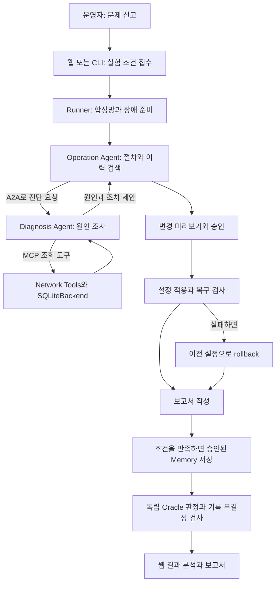
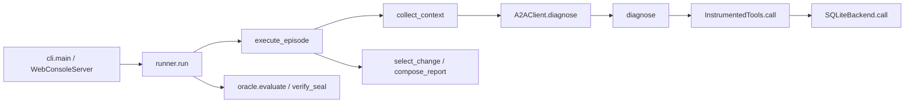

# NetOps Studio

**두 AI Agent가 네트워크 장애를 진단하고, 설정을 고치고, 복구 여부까지 확인하는 연구용 Testbed입니다.** 웹에서 실험을 시작하고 각 단계의 요청·응답·결과를 볼 수 있습니다.

> 현재 네트워크는 **SQLite로 만든 합성 유선망**입니다. 실제 MCP/A2A 통신과 실제 LLM 호출 기능은 있지만, Mininet이나 물리 네트워크를 실행하는 버전은 아닙니다. 정보 최소화·가명화 같은 Protection도 아직 적용하지 않은 D0 기준선입니다.

## 처음 방문했다면

| 원하는 일 | 먼저 읽을 문서 |
|---|---|
| 프로그램이 무엇인지 이해하기 | 이 README의 [전체 동작](#workflow)과 [시나리오](#scenarios) |
| 처음 설치하고 무료로 실행하기 | [초보자 설치·실행 안내](docs/QUICKSTART.md) |
| 웹 버튼과 결과 화면 이해하기 | [웹 콘솔 사용법](docs/WEB_CONSOLE.md) |
| 코드가 연결되는 구조 이해하기 | [전체 구조와 함수 흐름](docs/ARCHITECTURE.md) |
| 특정 폴더·파일의 역할 찾기 | 아래 [폴더 지도](#folders), 각 폴더의 README |
| 모든 함수·클래스 위치 찾기 | [Python 전체 참조](docs/reference/python_functions.md), [웹 JavaScript 참조](docs/reference/web_functions.md) |
| GitHub에 올리기 전 점검하기 | [GitHub 등록 안내](docs/GITHUB_PREPARATION.md), [보안 안내](SECURITY.md) |

**추천 읽기 순서:** 이 파일 → QUICKSTART → ARCHITECTURE → 관심 있는 폴더 README → 함수 참조입니다. 처음부터 모든 함수를 읽을 필요는 없습니다.

<a id="workflow"></a>
## 1. 전체 동작을 한 번에 보기

예를 들어 사용자가 “공유 서버로 파일을 옮기는 속도가 너무 느립니다”라고 요청했다고 생각해 보세요.



| 단계 | 쉬운 설명 | 주로 읽을 코드 |
|---|---|---|
| 요청 접수 | 웹 버튼 또는 명령어의 조건을 읽습니다. | [cli.py](src/ccs/cli.py), [web_console.py](src/ccs/web_console.py) |
| 실험 준비 | 매번 새로운 합성망 DB와 장애를 만듭니다. | [runner.py](src/ccs/runner.py), [bench](src/ccs/bench/README.md) |
| 자료 검색 | Runbook은 운영 절차, Memory는 과거 사건 기록입니다. | [knowledge 저장소](src/ccs/knowledge/README.md) |
| 진단 | 현재 설정·알람·KPI를 조회하고 원인과 조치를 제안합니다. | [agent_runtime.py](src/ccs/agent_runtime.py) |
| 조치 | 승인·버전·중복 요청 규칙을 확인한 뒤 변경합니다. | [netops](src/ccs/netops/README.md) |
| 확인 | Agent의 보고와 실제 망 상태를 따로 비교합니다. | [evaluation](src/ccs/evaluation/README.md) |
| 기록 | 도구 입출력·정보 전달·사용량·결과 hash를 남깁니다. | [core](src/ccs/core/README.md), [관찰 안내](docs/OBSERVABILITY.md) |

### 두 Agent와 Runner

- **Operation Agent:** 전체 일을 진행하는 담당자입니다. 참고자료를 고르고 진단을 요청하며, 조치를 제출하고 결과를 보고합니다.
- **Diagnosis Agent:** 원인을 조사하는 담당자입니다. 조회용 도구만 사용하며 네트워크 설정을 직접 바꿀 수 없습니다.
- **Runner:** Agent 밖에서 순서·승인·실행·검증을 관리하는 프로그램입니다. 실제 변경 권한을 모델의 자유로운 문장에 맡기지 않습니다.

MCP는 Agent가 도구를 사용하는 통신 규약이고, A2A는 Agent 사이에 진단 작업을 전달하는 통신 규약입니다. [용어집](docs/GLOSSARY.md)과 [프로토콜 안내](src/ccs/protocols/README.md)에서 더 자세히 설명합니다.

<a id="scenarios"></a>
## 2. 어떤 상황을 실험하나요?

| ID | 사용자가 겪는 문제 | 합성망에서의 원인 | 기대하는 처리 |
|---|---|---|---|
| W1 | 서버 연결이 끊깁니다. | 주 경로의 스위치 장애 | 정상 우회 경로로 복구 |
| W2 | 사내 서버에 접속되지 않습니다. | 잘못된 기본 gateway | 올바른 경로 설정 복원 |
| W3 | 회의 화면과 음성이 끊깁니다. | 패킷 손실 설정 | 손실 설정 복원 |
| W4 | 파일 전송이 느립니다. | 낮은 대역폭 제한 | 대역폭 설정 복원 |
| W5 | 대화 반응이 늦습니다. | 과도한 지연 설정 | 지연 설정 복원 |
| N0 | 신고는 있었지만 지금은 정상입니다. | 현재 장애 없음 | 설정을 바꾸지 않고 확인·보고 |

- **L1/L2/L3**는 실험 난이도 label입니다. 현재 구현은 다른 장비의 방해 알람을 각각 0/1/2개 추가합니다. IP 계층의 Layer 2/3을 뜻하는 label이 아닙니다.
- **Seed**는 합성 데이터와 요청 표현을 만드는 초기값입니다. 같은 seed가 실제 LLM 응답과 처리시간까지 똑같게 보장하지는 않습니다.
- **Repeat**는 같은 run 안에서 사건을 반복하는 횟수입니다. Memory를 켜면 뒤 episode가 앞 episode의 이력을 읽을 수 있습니다.

[시나리오 상세](docs/WIRED_SCENARIOS.md) · [과거 검증 결과의 공개 요약](docs/RESULTS.md)

<a id="quickstart"></a>
## 3. 가장 먼저 해볼 무료 실행

현재 검증 대상은 **Windows PowerShell + Python 3.14**입니다. 코드가 선언한 최소 Python은 3.11이지만 모든 버전·OS를 검증했다는 뜻은 아닙니다. Windows 전용 dependency가 있으므로 Linux 설치 완료를 가정하지 마세요.

처음이라면 아래 요약보다 [QUICKSTART](docs/QUICKSTART.md)의 단계별 설명부터 따라가세요.

```powershell
# 저장소 루트에서 실행합니다. D:가 없다면 쓰기 가능한 경로로 바꿉니다.
$workRoot = 'D:\Codex\WorkingFiles\ccs-testbed'
$env:CCS_WORKING_ROOT = Join-Path $workRoot 'working'
$env:CCS_WEB_WORKSPACE = Join-Path $workRoot 'web'

# 가상환경과 고정 패키지를 준비하고, 없는 로컬 설정만 생성합니다.
.\setup.ps1 -VenvPath (Join-Path $workRoot 'venv') -WorkDirectory (Join-Path $workRoot 'setup-cache')
.\ccs.ps1 doctor

# Mock은 실제 MCP/A2A를 쓰지만 유료 모델은 호출하지 않습니다.
.\ccs.ps1 run --mode mock --faults W4 --seeds 1 --output-root (Join-Path $workRoot 'runs')
.\ccs.ps1 web --port 0 --workspace (Join-Path $workRoot 'web')
```

웹 서버가 `Web console: http://127.0.0.1:.../?token=...`를 출력하면 그 **전체 주소**로 접속합니다. `실행 설정 → 실시간 모니터링 → 결과 분석` 순서로 확인합니다. 종료는 서버를 실행한 PowerShell 창에서 `Ctrl+C`입니다.

처음에는 **Mock / W4 / seed 1 / 반복 1 / No Delay**로 시작하세요. Live는 실제 공급사 API를 호출하므로 [Live 준비 안내](docs/QUICKSTART.md#live)를 먼저 읽으세요. 저장소를 내려받는 것만으로 API Key가 생기지는 않습니다.

<a id="folders"></a>
## 4. 폴더와 파일 지도

GitHub는 폴더를 열었을 때 그 폴더의 `README.md`를 보여 줍니다. 아래 링크에서 파일별 설명과 함수 흐름으로 이어집니다.

```text
04.Testbed/                 Git 저장소 루트
├── README.md               전체 안내
├── setup.ps1 / ccs.ps1     환경 준비 / 프로그램 실행
├── pyproject.toml          패키지·의존성·pytest 설정
├── requirements.lock       정확한 dependency 버전
├── .gitignore              개인 설정·출력·캐시 제외
├── .gitattributes          텍스트 줄바꿈 처리
├── SECURITY.md             비밀값·원문 취급 기준
├── CONTRIBUTING.md         수정·검증 절차
├── configs/                예제 XML과 로컬 설정
├── prompts/                두 Agent의 영어 지침
├── knowledge/runbooks/     영어 운영 절차 6개
├── src/ccs/                실제 Python 프로그램
│   ├── bench/              합성망·장애 생성
│   ├── core/               이벤트·Gateway·무결성
│   ├── evaluation/         Oracle·공개량 ledger
│   ├── knowledge/          문서·Memory 검색·저장
│   ├── netops/             도구·SQLite 망 상태
│   └── protocols/          MCP/A2A transport·인증
├── tests/                  무료 회귀검사
├── tools/                  문서 생성·공개 점검
├── docs/                   설치·구조·실험 결과 안내
│   └── reference/          전체 함수 참조
└── .github/workflows/      GitHub Actions 검사
```

| 폴더 | 파일·함수 설명 | 언제 수정하나요? |
|---|---|---|
| `configs/` | [설정 필드와 경로 규칙](configs/README.md) | 모델·예산·경로·실험 조건 |
| `prompts/` | [phase와 Agent 지침](prompts/README.md) | 모델의 행동 지침 |
| `knowledge/` | [지식 자료 구조](knowledge/README.md) | 참고자료 배치 |
| `knowledge/runbooks/` | [절차 6개와 metadata](knowledge/runbooks/README.md) | 운영 절차 |
| `src/` | [코드 읽기 진입점](src/README.md) | 전체 소스 탐색 |
| `src/ccs/` | [직접 파일과 함수 연결](src/ccs/README.md) | 실행 로직 |
| `tests/` | [검사별 목적·실행 방법](tests/README.md) | 회귀검사 |
| `tools/` | [문서·공개 관리 도구](tools/README.md) | 참조 재생성·공개 점검 |
| `docs/` | [문서 목차](docs/README.md) | 안내서 |
| `.github/` | [자동 검사](.github/README.md) | 원격 CI |

### 루트 파일의 역할과 공개 여부

| 파일 | 역할 | Git 등록 |
|---|---|---|
| `setup.ps1` | 환경 준비, lock 설치, 없는 XML 생성 | 포함 |
| `ccs.ps1` | 선택한 Python으로 `python -m ccs` 실행 | 포함 |
| `pyproject.toml` | Python 조건·dependency·CLI entry point | 포함 |
| `requirements.lock` | 재현을 돕는 설치 입력. 빌드 출력이 아닙니다. | **포함** |
| `.gitignore`, `.gitattributes` | 제외 대상·줄바꿈 규칙 | 포함 |
| `.ccs-python` | 이 PC의 Python 경로 | 제외 |
| `.git/` | Git 내부 index와 이력 | 직접 업로드하지 않음 |
| `configs/ai.local.xml`, `configs/system.xml` | Key·개인 경로가 들어갈 수 있는 실제 설정 | 제외 |
| `local-data/`, `.venv/`, run 폴더 | 생성된 상태·환경·결과 | 제외 |

<a id="functions"></a>
## 5. 함수를 읽는 순서

`cli.main()` → `runner.run()` → `runner.execute_episode()`를 먼저 따라가세요. 웹의 시작 버튼은 `WebConsoleServer.start_run()`을 거쳐 같은 runner에 연결됩니다.



HTTP로 건너가는 호출은 같은 Python 함수 stack에서 이어지는 것이 아닙니다. 작은 helper·중첩 handler는 [전체 Python 참조](docs/reference/python_functions.md), 버튼과 화면 갱신은 [JavaScript 참조](docs/reference/web_functions.md)에서 찾습니다. [모듈 계약](docs/MODULE_CONTRACTS.md)은 이 경계에서 어떤 데이터를 주고받는지 설명합니다.

## 6. 결과 해석

- **COMPLETED:** 실행계가 마무리됐습니다. 실제 복구는 Oracle utility와 verify를 함께 봅니다.
- **RECOVERED:** 장애 상황에서 복구를 확인한 episode 결과입니다.
- **NO_CHANGE:** 현재 정상이라 설정을 바꾸지 않은 결과입니다.
- **FAILED / ABORTED:** 모델·실행·저장 경로의 실패나 중단입니다. 부분 결과와 비용을 보존합니다.
- **INVALID_ARTIFACT:** 기록 무결성을 통과하지 못한 상태입니다. 정상 성공률에 섞지 않습니다.

[검증 기준](docs/VALIDATION.md) · [공개 결과 요약](docs/RESULTS.md) · [구현 상태](docs/STATUS.md)

## 7. GitHub 등록 전 확인

준비한 가상환경의 Python으로 다음을 실행합니다.

```powershell
python tools/generate_reference.py --check
python tools/check_repository.py
git status --short
git add --dry-run .
```

실제 commit/push는 [GitHub 등록 안내](docs/GITHUB_PREPARATION.md)를 따라 진행합니다. 위 검사 도구는 원격 저장소를 생성하거나 push하지 않습니다.

## 8. 현재 범위

- 검증 범위: Windows, 고정 Python/SDK, SQLite 합성망, Mock 및 제한된 실제 GPT 실험.
- 별도 검증 필요: 다른 OS/Python, 다른 모델, Memory 효과, Protection, Mininet/물리망 성능.
- 라이선스는 아직 지정하지 않았습니다. 공개 범위와 재사용 허용 조건은 저장소 소유자가 결정해야 합니다.

[기여 방법](CONTRIBUTING.md) · [보안 안내](SECURITY.md) · [문서 목차](docs/README.md)
