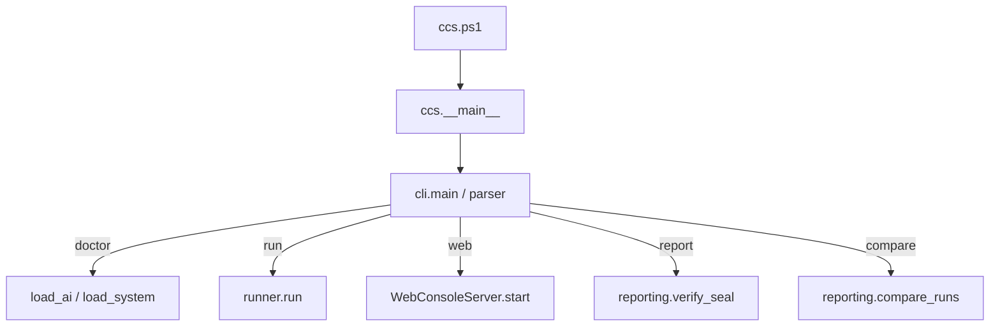
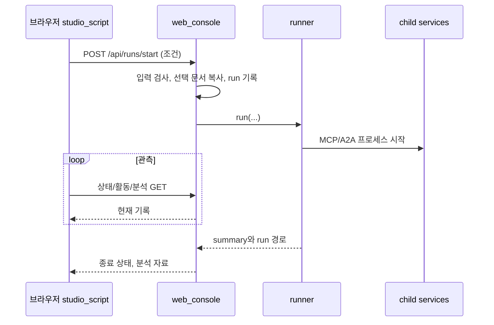

# 전체 구조와 함수 흐름

[프로젝트 처음으로](../README.md) · [문서 목차](README.md) · [소스 파일 지도](../src/ccs/README.md)

## 1. 프로그램과 AI 모델의 구분

이 저장소의 Python 프로그램이 순서를 관리하고, Live 모드에서 외부 LLM에게 제한된 도구 선택과 구조화 응답을 요청합니다. AI 모델 자체를 이 저장소가 학습하거나 실행하는 것은 아닙니다. Mock 모드는 같은 프로그램 흐름에 정해진 판단을 넣습니다.

| 구성 | 실행 위치/역할 | 시작점 |
|---|---|---|
| CLI/웹 controller | 부모 프로세스, 조건과 사용자 조작 | `cli.main`, `WebConsoleServer` |
| Runner/Operation | 부모 실행 작업, 자료 선택과 전체 workflow | `run`, `execute_episode`, `collect_context` |
| Network Tools | 별도 localhost 서비스, 망 조회·변경 | `services.main(kind='tools')` |
| Diagnosis | 별도 localhost 서비스, 조회 기반 진단 | `services.main(kind='diagnosis')` |
| Oracle/보고서 | 실행 후 실제 상태·기록을 평가 | `evaluate`, `write_reports`, `verify_seal` |

`processes.Services`가 두 child 서비스를 띄우고 준비·종료·timeout을 관리합니다. 실험 데이터는 하나의 run 폴더에 모으지만 이벤트 writer는 서로 다른 파일을 사용합니다.

## 2. CLI 진입 경로

`ccs.ps1`은 Python을 찾는 얇은 wrapper입니다. 실제 명령 선택은 `cli.py`가 합니다. 설정은 `config.py`가 엄격히 읽고, 비용 계산·예약은 `budget.py`가 맡습니다. `report`는 기존 파일을 다시 생성하는 명령이 아니라 봉인된 결과를 읽기 전용으로 검사하는 명령입니다.

## 3. 웹 버튼에서 실험까지

웹도 같은 `runner.run()`을 사용합니다. 별도의 다른 AI 시스템이 아닙니다. 서버는 token, host/origin, LAN 허용 범위를 확인하고, 실행은 background worker에서 진행합니다.

| 화면 코드 | 하는 일 |
|---|---|
| `studio_markup.py` | 버튼·입력창·탭 등의 HTML 구조 |
| `studio_styles.py` | 색·간격·반응형 배치 CSS |
| `studio_script.py` | 시작/중지/자료관리/언어/결과 요청과 화면 갱신 |
| `web_ui.py` | 위 세 조각을 문서로 조립 |
| `monitor.py`, `monitor_i18n.py` | 상세 활동 iframe/독립 monitor와 번역 |
| `network_view.py` | 현재/초기/완료 네트워크 상태를 화면용으로 정리 |
| `run_analysis.py` | 실제 기록에서 진단·조치·KPI 전후·제한을 분석 |

브라우저에는 이름 있는 함수 외에도 버튼에 연결한 익명 callback이 있습니다. 실험 시작 callback은 입력값을 `/api/runs/start`로 보내고, 조회 주기는 상태·network·analysis를 가져와 render 함수에 전달합니다. 파일 안의 이름 있는 함수는 [웹 함수 참조](reference/web_functions.md)에 나열했습니다.

## 4. 한 episode의 핵심 함수

| 순서 | 함수/메서드 | 들어오는 것 | 나가는 것 |
|---|---|---|---|
| 1 | `create_world` | fault, seed, target, difficulty | 망 DB와 scenario, evaluator용 정답 |
| 2 | `collect_context` | 운영 요청, Runbook/Memory 저장소 | 선택한 incident/context |
| 3 | `A2AClient.diagnose` | `DiagnosisRequest` | `DiagnosisResult` |
| 4 | `diagnose` | 요청·도구·예산 | 원인, 근거, 실행 전 조치 제안 |
| 5 | `select_change` | 진단 결과 | 변경 후보 또는 None |
| 6 | `preview_change` / `apply_change` | 변경과 승인·token | 실제 적용 결과 |
| 7 | `verify_service` / 필요 시 `rollback_change` | 현재 망 상태 | 검사 결과 / 되돌림 결과 |
| 8 | `compose_report` | 검증된 실행 사실 | outcome이 사실과 일치하는 보고서 |
| 9 | `propose_memory` / `MemoryStore.write` | 승인된 성공 기록 | 다음 episode가 검색할 수 있는 이력 |
| 10 | `oracle.evaluate` | 최종 DB와 evaluator용 scenario | utility, 금지 변경, 실제 상태 판정 |

여기서 함수 호출처럼 보이는 이름 중 Network Tools는 MCP를 통해 실행합니다. Diagnosis는 조회만 하고, 실제 apply/rollback은 Runner가 Operation 역할로 수행합니다. Agent 보고가 Oracle의 입력 정답으로 사용되지는 않습니다.

## 5. 데이터가 저장되는 곳

| 데이터 | 목적 | 공개 저장소 포함 |
|---|---|---|
| `configs/*.example.xml` | 다른 사람이 시작할 수 있는 빈 설정 틀 | 포함 |
| 실제 local XML | Key, 개인 경로, 실제 운영 설정 | 제외 |
| `prompts/*.txt` | Agent 지침 | 포함 |
| `knowledge/runbooks/*.md` | 합성망 운영 절차 | 포함. README는 Agent 입력에서 제외 |
| `network.sqlite` | episode의 합성 망 상태 | 제외 |
| `runbooks.sqlite`, `memory.sqlite` | 검색 index와 incident 기록 | 제외 |
| `events/`, `blobs/`, `activity/` | 경계별 원문·활동 증거 | 제외 |
| `summary.json`, `report.html` | 생성된 집계 결과 | 기본 제외. 공개 요약은 별도 검토 |
| `manifest.json` | 조건·환경·source hash·파일 hash | 실행 artifact로 보존, 기본 제외 |

### 경로는 세 가지를 구분합니다

1. **소스 경로:** 프로그램과 공개 문서가 있는 저장소입니다.
2. **출력 경로:** `system.xml.paths.output_root` 또는 CLI override 아래의 run 폴더입니다.
3. **웹 workspace:** 문서 선택·실행 목록·Delay 설정을 저장합니다. output_root와 다릅니다.

[paths.py](../src/ccs/paths.py)는 기본 working/web 경로를 계산합니다. [configs 안내](../configs/README.md)에서 XML의 서로 다른 상대 경로 기준도 확인하세요.

## 6. 실패를 다루는 방식

- 모델이 허용되지 않은 형식의 응답을 반환하면 제한된 repair 후 실패합니다. 임의로 성공으로 변환하지 않습니다.
- 도구 조회에는 제한된 재시도가 있고, 변경 중복은 idempotency key와 preview token으로 관리합니다.
- 실제 복구 검사 실패는 rollback과 명시적 episode 결과로 남깁니다.
- 마무리 저장 단계 실패는 부분 실행으로 남기고 정상 봉인된 성공과 구분합니다.
- 포트 bind 실패는 요청 host/port와 socket 오류를 알려 줍니다. 명시한 포트를 조용히 다른 포트로 바꾸지 않습니다.

## 7. 기능을 바꾸려면 어디부터 볼까요?

| 변경 목적 | 첫 진입점 | 함께 확인 |
|---|---|---|
| 시나리오 추가 | [bench](../src/ccs/bench/README.md) | catalog, runbook, Oracle, tests |
| Agent 지침 변경 | [prompts](../prompts/README.md) | agent_runtime의 도구 계약, Live 결과 세대 구분 |
| 도구 추가 | [netops](../src/ccs/netops/README.md) | 역할 schema, MCP 계약, backend·Oracle |
| 프로토콜 변경 | [protocols](../src/ccs/protocols/README.md) | timeout, schema, 인증, causal metadata |
| 검색·Memory 변경 | [knowledge](../src/ccs/knowledge/README.md) | metadata, retention purpose, 재사용 조건 |
| 계측 변경 | [core](../src/ccs/core/README.md) | event schema, blob, read-only integrity |
| 웹 변경 | [src/ccs](../src/ccs/README.md) | markup/style/script와 controller API |

전체 함수는 [Python 참조](reference/python_functions.md)에 있고, 경계별 입력/출력의 정확한 약속은 [MODULE_CONTRACTS](MODULE_CONTRACTS.md)에 있습니다.
