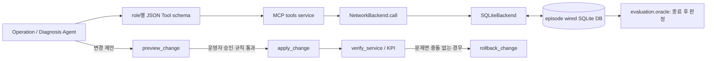

# Wired NetworkBackend 계약 안내

이 문서는 Agent가 네트워크를 읽고 바꿀 때 거치는 **Network Tool → backend → 합성 상태 DB** 경계를 설명합니다. 처음 읽는다면 [소스 폴더 안내](../src/ccs/netops/README.md)를 먼저 보고, 이후 이 문서의 도구 표와 변경 순서를 따라가세요.

## 용어 먼저 보기

| 용어 | 쉬운 설명 | 현재 코드에서의 의미 |
|---|---|---|
| Network Tool | Agent가 정해진 이름과 JSON 인자로 요청하는 작업 | `list_alarms`, `preview_change` 같은 MCP 도구 |
| `NetworkBackend` | 도구 handler와 망 구현 사이의 약속 | `call`, `snapshot`, `close`만 노출하는 Python `Protocol` |
| `SQLiteBackend` | 현재 약속을 구현한 망 상태 저장소 | wired world를 SQLite로 계산·저장하며 외부 장비에는 접속하지 않음 |
| preview | 변경을 적용하기 전에 값과 현재 상태 버전을 검사한 확인서 | `change_token`, 제안된 diff, 기준 version을 묶음 |
| idempotency key | 같은 요청 재전송으로 변경이 두 번 적용되지 않게 하는 식별자 | 같은 key와 같은 요청은 기존 결과를 돌려주고, 다른 요청의 재사용은 충돌 |
| Oracle | Agent의 말과 분리된 최종 상태 판정기 | 종료된 episode DB와 evaluator-only 시나리오를 비교 |

## 데이터가 지나가는 길



도구의 role별 공개 표면은 [`tool_schemas(role)`](../src/ccs/netops/tools.py)에서 정하고, MCP service는 실제 호출 때 role과 schema를 다시 검사합니다. backend handler는 [`NetworkBackend`](../src/ccs/netops/backend.py) 약속을 사용합니다. SQLite 세부 구현은 [`SQLiteBackend`](../src/ccs/netops/sqlite_backend.py)에 있습니다.

### Backend interface

```python
class NetworkBackend(Protocol):
    def call(self, tool: str, arguments: dict[str, Any]) -> dict[str, Any]: ...
    def snapshot(self) -> dict[str, Any]: ...
    def close(self) -> None: ...
```

- `call(...)`은 공개된 도구 하나를 실행해 JSON-compatible 결과를 돌려줍니다. 이름과 인자가 계약에 맞지 않으면 backend 예외를 발생시킵니다.
- `snapshot()`은 Oracle·UI projection 등 내부 사용자가 보는 canonical offline 상태입니다. Agent에게 공개되는 Network Tool이 아닙니다.
- `close()`는 연결 자원을 닫습니다. context manager를 사용하면 정상·예외 종료에서 정리를 수행합니다.
- `SQLiteBackend`는 자신을 `sqlite-wired-v1`, schema version `2`로 표시합니다. 구형 DB를 wired DB로 추측해 읽지 않고 거부합니다.

## 제공하는 도구

모든 응답은 크기 제한이 있습니다. 아래는 schema상 이름과 역할 설명이며 실제 세부 필드는 [도구 schema 소스](../src/ccs/netops/tools.py)와 전체 함수 참조에서 확인할 수 있습니다.

| 그룹 | 도구 | 역할과 주의점 |
|---|---|---|
| 읽기 | `list_alarms` | wired operational alarm을 읽습니다. `scope`를 생략하면 영향을 받은 node를 찾는 데 쓸 수 있고, `window`는 분 단위가 아닌 logical tick 범위입니다. |
| 읽기 | `get_kpi` | 대상의 `throughput_mbps`, `latency_ms`, `packet_loss_pct`, `reachability_pct`를 읽습니다. 첫 조회에서 `metrics`를 생략해 정확한 이름을 확인할 수 있습니다. |
| 읽기 | `get_logs` | 한 대상의 제한된 log line을 조회합니다. 줄 안에 host/flow 식별자가 있을 수 있습니다. |
| 읽기 | `get_config` | 대상의 현재 설정과 일반 기준 설정을 읽습니다. 허용 parameter는 `active_path`, `admin_state`, `default_gateway`, `loss_pct`, `bandwidth_mbps`, `delay_ms`입니다. 기준값과 현재값 차이만으로 fault 원인을 단정하지 말고 topology·alarm과 같이 확인합니다. |
| 읽기 | `get_topology` | 네트워크 대상 주변의 제한된 topology를 조회합니다. 깊이 `0..2`입니다. |
| 읽기 | `lookup_flows` | `host`, `src_ip`, `dst_ip` 조건으로 제한된 flow를 검색합니다. |
| 변경 | `preview_change` | `target`, `param`, `value`, `reason`을 검증해 상태 버전에 묶인 preview를 만듭니다. 아직 망을 바꾸지 않습니다. |
| 변경 | `apply_change` | 신선한 `change_token`과 `idempotency_key`에 정확히 묶인 값을 적용합니다. |
| 변경 | `get_change_status` | idempotency key로 durable change 결과를 다시 읽습니다. 결과를 모를 때 동일 요청을 새 key로 무작정 반복하지 마세요. |
| 변경 | `rollback_change` | `change_id`와 idempotency key로 바로 앞 변경을 되돌립니다. 뒤이어 다른 변경이 생겨 충돌하면 적용하지 않습니다. |
| 변경 | `verify_service` | 현재 상태와 결정론적 predicate로 서비스 검사를 수행합니다. 실행 결과를 확인하는 읽기성 검증 작업이며 agent 보고문이 아닙니다. |
| 변경 | `update_ticket` | incident ticket의 상태와 제한된 operator note를 갱신합니다. 허용 status는 `open`, `investigating`, `resolved`, `escalated`입니다. |

### Agent 권한

- `diagnosis`는 읽기 도구 6개만 받습니다. 진단 단계에서 DB를 직접 수정할 수 없습니다.
- `operation`은 읽기 도구와 변경 도구를 받습니다. 변경 권한이 공개되더라도 preview, workflow 승인, apply, verify 단계를 건너뛰는 권한은 아닙니다.
- MCP handler 안에 SQL, Mininet 명령, emulator 전용 동작을 넣지 않습니다. 새 backend를 추가할 때는 같은 `NetworkBackend` 계약을 구현하고 conformance 검사를 유지해야 합니다.

## 안전한 변경 순서

1. alarms/logs/KPI/topology/config를 읽어 고장 위치와 증거를 찾습니다.
2. Operation Agent가 제안한 `target`, `param`, `value`, `reason`으로 `preview_change`를 호출합니다. 값과 현재 state version이 유효한지 확인합니다.
3. Runner가 system 설정에 따른 승인 정책을 평가합니다. 승인이 되기 전에는 `apply_change`를 호출하지 않습니다.
4. `apply_change(change_token, idempotency_key)`로 preview에 고정된 변경을 적용합니다. 한 번 결과가 기록된 key를 같은 값 재시도에 사용하면 중복 적용 대신 기존 결과를 찾습니다.
5. `verify_service`와 KPI를 확인합니다. Preview 후 다른 변경이 적용되어 version이 변했다면 stale preview이므로 새 상태를 읽고 다시 preview해야 합니다.
6. verify가 실패하고 이후 변경과 충돌하지 않을 때만 `rollback_change`로 되돌립니다. rollback도 별도 결과로 남습니다.
7. episode 종료 후 Oracle이 초기 snapshot과 최종 snapshot을 비교합니다. Agent가 “성공”이라고 보고했는지는 Oracle 입력이 아닙니다.

## 오류를 어떻게 해석할까요?

| 예외 | 의미 | 다음 확인 |
|---|---|---|
| `ContractError` | 도구 인자 또는 필드가 schema/domain 규칙에 맞지 않음 | 도구 schema, enum, 길이/수치 범위를 확인 |
| `UnknownToolError` | 안정된 도구 목록 밖의 이름 | role에 허용된 이름을 `tools/list` 또는 `tool_schemas`에서 확인 |
| `NotFoundError` | 대상·preview·change·ticket ID가 없음 | 정확한 ID와 실행 기록 확인 |
| `VersionConflictError` | preview/rollback 기준 뒤 상태가 바뀜 | 최신 상태를 읽고 새 preview를 생성 |
| `IdempotencyConflictError` | 이미 다른 요청에 쓴 key를 다른 요청에 재사용 | 원래 요청의 상태를 조회하고 고유 key 사용 |
| `ChangeConflictError` | 객체가 현재 lifecycle 상태에서 바뀔 수 없음 | change 상태와 선행·후속 작업을 확인 |

## 시나리오와 한계

`bench.scenarios.create_world(...)`는 깨끗한 DB와 evaluator-only 메타데이터를 별도로 만듭니다. Agent가 보는 요청/초기 operational state와 ground truth·registry·initial snapshot은 분리합니다. Oracle은 terminal episode 뒤 실제 DB final state, 결정론적 verify, 허용 변경을 사용합니다. N0 정상 시나리오는 network mutation을 하지 않는 것이 기대 결과입니다.

현재 KPI는 SQLite authoring 값이며 실제 packet capture나 운영 traffic 측정이 아닙니다. 기본 대상은 `HOST-001`, topology는 유선 host·switch·router·interface·primary/backup link·flow입니다. Mobile network entity와 tool이 없고, Mininet도 현재 이 backend의 실행 구현이 아니라 별도 후속 검증 계획입니다. W1에서는 backup path가 건강해도 고장난 primary switch 자체를 고쳤다고 판정하지 않습니다. 더 읽을 내용은 [유선 시나리오](WIRED_SCENARIOS.md), [현재 상태와 한계](STATUS.md)입니다.
