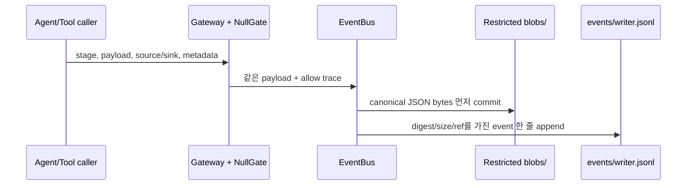

# 계측, Runbook 검색, Incident Memory

이 문서는 네 종류 데이터를 구분하는 안내입니다. (1) D0 gateway를 통과한 입력 payload의 restricted disclosure event, (2) 운영 화면용 안전 활동 로그, (3) 검색된 Runbook/Memory, (4) 실행 종료 뒤 수행하는 offline 검사입니다. 처음 읽는다면 [core 소스 안내](../src/ccs/core/README.md), [knowledge 소스 안내](../src/ccs/knowledge/README.md), [결과 읽기](RESULTS.md)를 옆에 두세요.

## 중요한 용어

| 용어 | 의미 |
|---|---|
| `EventBus` | 프로세스 한 개가 소유하는 append-only disclosure event writer |
| payload blob | event가 가리키는 JSON payload 원문. `blobs/`에 저장하며 restricted입니다. |
| event shard | 한 writer가 append하는 JSONL event 목록. `events/<writer_id>.jsonl` |
| `Gateway` / `NullGate` | lifecycle crossing에서 payload를 gate에 주고 event로 기록하는 연결. 현재 `NullGate`는 같은 객체 그대로 허용합니다. |
| activity log | 사람이 live monitor/console에서 볼 수 있도록 caller가 고른 내용을 scrub해 쌓은 별도 로그 |
| Oracle | episode 종료 시 DB의 실제 최종 상태를 평가하는 쪽. event ledger나 Agent 보고문과는 다른 판단입니다. |

## D0에서 한 event는 어떻게 만들어지나요?



간단한 호출 예입니다. `run_dir`은 특정 실행의 결과 디렉터리입니다.

```python
bus = EventBus(run_dir, "runner", run_id, episode_id)
gateway = Gateway(bus)
payload_after_gate, event_id = gateway.pass_through(
    "G1",
    payload,
    "operator",
    "agent:operation",
    trace_id=trace_id,
    task_id=task_id,
    authenticated_principal="operator-sim",
    principal_role="operation",
)
```

`NullGate`는 payload를 복사하거나 가공하지 않고 허용합니다. `EventBus`는 payload를 canonical JSON bytes로 serialize해 `blobs/<event_id>.json`에 저장한 뒤 `events/<writer_id>.jsonl`에 digest·size·reference를 담은 event를 추가합니다. 따라서 이 경로는 측정 지점이지만 masking/filtering/pseudonymization 동작은 아닙니다. payload 원문, digest, blob은 공개 report에 넣지 않습니다.

### Lifecycle stage 이름

허용 stage는 다음 아홉 개입니다.

| Stage | 의미 |
|---|---|
| `G1` | operator input이 Operation에 들어오는 경계 |
| `G2` | 검색 문서가 context에 들어오는 경계 |
| `G3r`, `G3w` | Memory read/write 경계 |
| `G4.call`, `G4.ret` | Network Tool 요청과 결과 |
| `G5.req`, `G5.res` | A2A agent-to-agent 요청과 응답 |
| `G6` | 사용자에게 최종 결과를 돌려주는 경계 |

**Stage 이름이 선언되었다고 해당 정책이 구현된 것은 아닙니다.** D0의 `NullGate`는 모든 payload를 그대로 허용하므로 disclosure protection을 제공하지 않습니다. 단계 이름은 측정 경계를 표시합니다. 실제 구현 범위는 [전체 구조](ARCHITECTURE.md)와 [구현 상태](STATUS.md)를 읽고 코드에서 확인하세요.

### event metadata와 process 경계

`EventBus.emit(stage, payload, source, sink, *, causation_event_id=None, transport="local", status="succeeded", **metadata) -> event_id`가 schema를 만족하는 event를 기록합니다. 흔히 쓰는 metadata는 `trace_id`, `span_id`, `parent_span_id`, `task_id`, `attempt`, `authenticated_principal`, `principal_role`, `purpose`, `ts_logical`입니다. 추가 JSON-safe 값은 `metadata`에 담깁니다. 단일 writer가 shard를 소유하므로 프로세스마다 고유 `writer_id`를 씁니다.

MCP 요청에서는 caller가 `G4.call`, tools process가 직접 발생한 `G4.ret`를 기록하고 response의 `causation_event_id`에 요청 event ID를 넣습니다. 실패 응답도 `status="failed"`인 `G4.ret` event로 쌍을 이룹니다. A2A는 같은 원리로 `G5.req → G5.res`를 기록합니다. Diagnosis가 요청을 받아 다시 MCP를 부르면 nested call의 causation을 연결할 수 있습니다. Tool service의 `_ccs_event_id`는 계측 연결용 metadata라 Agent 결과에 넘기기 전에 Operation-side gateway가 소비합니다.

runner의 `episode-0001` 형식 episode ID는 숫자로부터 일관된 `episode_seq`를 계산해 child writer끼리도 맞춥니다. 다른 임의 episode ID를 여러 프로세스에서 사용한다면 caller가 순서를 조정해야 하며, 다른 sequence로 기록된 event는 검증에서 실패합니다. default `trace_id`는 같은 run/episode 동안 writer 간 안정적이지만, 가능하면 orchestrator가 만든 trace를 명시적으로 전달합니다.

## 읽기 전용 검사와 merge

```python
from ccs.core.integrity import validate_events, validate_and_merge

check = validate_events(run_dir)          # 파일을 추가/수정/삭제하지 않음
merged = validate_and_merge(run_dir)      # 유효한 경우에만 merge JSONL 생성
```

`validate_events(run_dir)`는 event, shard, blob, manifest를 검사하지만 결과물 파일을 만들거나 바꾸지 않습니다. `validate_and_merge(run_dir)`는 같은 수준의 검사를 수행하고 모두 통과했을 때 `events_merged.jsonl`을 씁니다. 유효하지 않은 결과를 성공으로 고치거나 합치지 않습니다.

검사 내용은 strict event field/schema, event/span/writer sequence 중복, `writer_id`와 shard 파일명 일치, writer 순번의 연속성, episode sequence 일관성, causation/parent-span 참조와 trace 연결, blob 1:1 참조·JSON·SHA-256·byte size, orphan blob, 인과 cycle, terminal request/response 짝을 포함합니다. merge는 causal graph의 topological order를 우선합니다. 동시에 가능했던 event의 deterministic tie-breaker는 `(episode_seq, ts_logical, writer_id, local_seq, event_id)`입니다. 서로 다른 process의 인과관계를 wall-clock timestamp만으로 추정하지 않습니다.

실행 도중 아직 끝나지 않은 요청은 응답 짝이 없어도 허용합니다. episode가 terminal이라고 확인된 뒤에는 모든 `G4.call`에 정확히 하나의 직접 발생 `G4.ret`, 모든 `G5.req`에 정확히 하나의 직접 발생 `G5.res`가 있어야 합니다. `failed` return은 정상적인 짝 증거로 인정되고, 별도로 표시된 duplicate delivery는 두 번째 성공 return으로 세지 않습니다. terminal은 event metadata나 manifest에서 확인합니다. 예를 들면:

```json
{"terminal": true, "status": "completed"}
```

```json
{"episodes": [{"episode_id": "episode-a", "status": "failed"}]}
```

`reporting.verify_seal(run_dir)`도 읽기 전용 검사이며 event 무결성 검사와 다른 수준의 전체 artifact seal 검증입니다. `validate_events`, seal, Oracle utility 세 결과를 서로 대신 사용하지 마세요.

## Offline sensitive-item ledger

`build_ledger(run_dir, registry)`는 event integrity가 유효한지 먼저 확인하고 validated blob을 offline에서 읽습니다. registry record는 `item_id`, `category`, `field`, `value`, `origin_stage`가 필요하고 `necessary_stages`, `origin_episode_id`는 선택값입니다. 여러 episode에서 생성된 registry를 모을 때 `origin_episode_id`를 붙이면 이미 처음부터 있던 값과 뒤 episode에서 새로 만들어진 값을 구분할 수 있습니다.

반환 ledger에는 hash, stage visit, 개수와 JSON path가 들어가지만 raw registry value는 반환하지 않습니다. 낮은 entropy의 값은 hash만으로도 추측할 수 있으므로 ledger 자체도 restricted로 둡니다. 중복 episode binding은 같은 category/field/origin/normalized value면 seed별 ID가 달라도 하나로 합치며 `registry_item_ids`, `necessary_stages`, origin episode 목록을 유지합니다. 따라서 B episode에 독립적으로 존재한 값이 A에서 누출된 값으로 잘못 집계되는 일을 줄입니다. 같은 사람이 읽는 `item_id`라도 seed별 value가 다를 수 있어 `binding_id`로 구분합니다. 같은 ID와 정규화 값에 상충 metadata를 부여하면 거부합니다. 여러 run 집계는 `item_id` 단독 대신 `aggregation_key`, `registry_fingerprint`로 정렬합니다. episode 바깥 visit은 `cross_episode`입니다.

현재 검사 fixture는 employee number, phone, IPv6, host ID, flow ID의 positive 5개와 near miss negative 5개를 분류하며 그 작은 fixture에서 precision/recall 1.0을 기대합니다. 이는 입력이 정해진 T-unit contract test이지 임의 production text에 대한 실측 precision/recall 추정이 아닙니다. Shard, merged events, blob 내용, registry, ledger를 public report에 복사하지 않습니다.

## Runbook retrieval

`runbook_files(directory)`는 디렉터리를 재귀 검색해 Markdown 파일을 찾되 이름이 대소문자 무관하게 `README.md`인 파일은 제외합니다. 따라서 이번 코드 안내 README들이 운영 Runbook index에 자동으로 섞이지 않습니다. 이 helper는 `runner`의 Runbook snapshot/source hash와 `web_console`의 library discovery에서 공유됩니다.

`RunbookStore(db_path, documents_dir)`은 선택된 영어 Markdown runbook을 SQLite FTS5로 index합니다. 각 운영 Runbook은 YAML front matter에 `doc_id`, `version`, `tenant`, `classification`, `source`가 필요합니다. 제목 아래 `##` headings 기준으로 chunk를 나눠 검색합니다. `search(query, k=3)`는 `{chunk_id, doc_id, text, meta, score}` 결과를 BM25 순서로 냅니다. Query text는 tokenization 후 FTS `MATCH`에 전달해 특수 구문이 검색문을 바꾸지 않게 하고, 검색 가능한 token이 없으면 빈 목록을 반환합니다. `runner`는 실행 전에 Runbook 복사본을 freeze하므로 실행 중 문서 수정이 그 실행 context를 바꾸지 않습니다.

현재 wired catalog의 운영 runbook은 switch failover, gateway correction, packet loss, bandwidth, delay, N0 no-action 안내를 다룹니다. 상세 검색 API와 파일은 [knowledge README](../src/ccs/knowledge/README.md)를 참고하세요.

## Memory 저장과 조회

`MemoryStore(db_path)`은 dictionary 또는 `ccs.contracts.MemoryRecord`를 받습니다. 일반 `write(record, verified=True, approved=True)`가 성공하려면 결과 검증과 운영자 승인이 둘 다 true여야 하고 `record_id` 중복은 거부합니다. `search(query, k=3)`는 BM25와 logical recency tie-breaker로 record와 `score`를 반환합니다. `import_reference`는 operator-seeded experimental context로 들어오는 별도 명시 경로입니다.

D0의 의도된 기준 동작으로 Memory read 시점에는 tenant/scope/expiry filtering도 retention 변환도 적용되지 않습니다. 동일 run-local DB를 연속 episode가 공유하면 이전 경험과 cross-episode disclosure를 관찰할 수 있습니다. 이 baseline 행위는 production access-control 정책이 아닙니다. stores 호출은 Operation 쪽에만 있고, Diagnosis는 A2A로 선택된 context만 받습니다. `Memory ON/OFF`와 저장 승인 여부는 별도 설정/결과에서 확인하세요.

## 어디서 더 읽을까요?

- [core package README](../src/ccs/core/README.md): `EventBus`, `Gateway`, `NullGate`, integrity API
- [knowledge package README](../src/ccs/knowledge/README.md): `runbook_files`, Runbook/Memory 파일 구조
- [MCP/A2A protocol guide](PROTOCOLS.md): wire request/response가 어떤 event를 만나는지
- [결과 읽기](RESULTS.md): restricted artifacts와 public report의 경계

