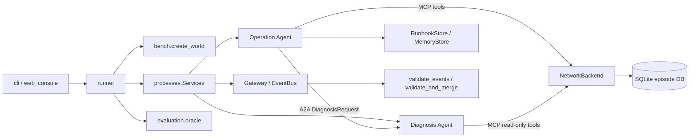

# Python 모듈 계약 지도

이 문서는 저장소의 주요 모듈들이 서로 주고받는 **약속(contract)** 을 초보자용으로 정리합니다. Contract는 서로 다른 파일/프로세스가 같은 이름, JSON field, 예외 의미를 전제로 협력하도록 정한 규칙입니다. 처음 읽는다면 [Python 소스 안내](../src/README.md), [패키지 전체 흐름](../src/ccs/README.md), [함수별 참조](reference/python_functions.md)를 함께 여세요.

## 전체 연결 순서



화살표는 모듈 경계를 요약한 것입니다. 내부의 모든 함수 호출/재시도 단계를 뜻하지 않습니다. 중요한 설계 방향은 Agent에게 실제 SQLite 저장 구조를 숨기고, 도구 schema, protocol, backend를 각각 교체 가능한 계약으로 분리한 점입니다.

## 데이터 형태와 공통 규칙

- 파일시스템 경로를 받는 API는 보통 `pathlib.Path`를 사용합니다. 구체 함수가 `str | Path`를 받는지 여부는 signature에서 확인하고, 설정에 들어 있는 경로는 config loader가 해석합니다.
- Agent·MCP·A2A payload와 대부분의 Tool 입력/출력은 JSON object, 즉 Python `dict`입니다. field 이름과 값은 code/schema에 선언된 형태로 보냅니다.
- 계약 위반은 `BackendError`/`ProtocolError` 같은 명시적 exception으로 보고합니다. 실패를 정상처럼 보이는 빈 결과로 조용히 바꾸지 않습니다. 검색 결과가 실제로 0개인 경우는 별도 정상 상태입니다.
- Provider와 독립된 Agent payload contract는 `src/ccs/contracts.py`의 Pydantic model입니다. `extra="forbid"`이므로 선언하지 않은 field를 거부합니다.
- 현재 backend는 SQLite wired simulation입니다. `NetworkBackend`는 interface이지 다른 backend의 구현·실망 검증 증거가 아닙니다.

## Backend 계약

`src/ccs/netops/backend.py`의 `NetworkBackend` protocol은 다음 세 method만 호출자에 약속합니다.

```python
call(tool: str, arguments: dict[str, Any]) -> dict[str, Any]
snapshot() -> dict[str, Any]
close() -> None
```

`SQLiteBackend(path)`은 이를 wired world DB 위에 구현합니다. Agent가 보는 schema는 `tool_schemas(role) -> list[dict]`이며 각 항목은 `{name, description, parameters}` 모양입니다. `diagnosis`에는 read-only 도구, `operation`에는 같은 읽기 도구와 변경 도구가 제공됩니다. MCP server는 tool listing뿐 아니라 실제 call에서도 role/schema를 다시 검사합니다. 자세한 preview/version/idempotency/rollback 규칙은 [Backend guide](BACKEND.md), 각 구현 파일은 [netops README](../src/ccs/netops/README.md)를 읽으세요.

`bench.scenarios.create_world(path, seed=1, fault_id="W4", target="HOST-001", difficulty="L1") -> dict`는 새 DB를 만들고 실행 요청 정보와 Oracle만 써야 하는 `ground_truth`, `registry`, `initial_snapshot`을 포함한 metadata를 반환합니다. Runner는 그 metadata를 Agent live prompt와 분리합니다. `evaluation.oracle.evaluate(db_path, scenario) -> dict`는 종료된 실제 DB 상태를 비교하고 `utility`, `verified`, `forbidden_changes`, `details`를 반환합니다. LLM이 쓴 report는 Oracle 입력이 아닙니다.

## 계측과 지식 계약

### EventBus와 Gateway

```python
EventBus(run_dir: Path, writer_id: str, run_id: str, episode_id: str)
EventBus.emit(
    stage, payload, source, sink, *,
    causation_event_id=None, transport="local", status="succeeded", **metadata
) -> str  # event_id
Gateway(bus).pass_through(stage, payload, source, sink, **metadata) -> (payload, event_id)
```

프로세스마다 고유 writer shard를 소유합니다. `NullGate`는 payload를 동일 객체 그대로 통과시키므로 D0는 payload transformation이 없습니다. event metadata와 payload blob은 restricted artifact입니다.

`validate_events(run_dir) -> dict`는 검사만 하는 read-only entrypoint입니다. `validate_and_merge(run_dir) -> dict`는 같은 무결성 조건을 만족하면 causal-order `events_merged.jsonl`을 생성합니다. terminal event에서 `G4.call → G4.ret`, `G5.req → G5.res` 응답 짝이 완전해야 합니다. API와 결과 해석은 [Instrumentation guide](INSTRUMENTATION.md), 세부 구현은 [core README](../src/ccs/core/README.md)를 보세요.

### Runbook과 Memory

`runbook_files(directory: Path) -> list[Path]`는 디렉터리 재귀 Runbook 탐색에서 이름이 case-insensitive `README.md`인 파일을 제외합니다. 이 helper가 `runner`의 snapshot/source hash와 `web_console` library discovery에 공유되므로 문서 안내 README가 Runbook으로 색인되지 않습니다.

`RunbookStore(db_path, documents_dir)`은 front matter가 있는 영어 Markdown 운영 문서를 SQLite FTS5/BM25로 검색합니다. 주요 API는 `search(query, k=3) -> list[dict]`, `close()`입니다. `MemoryStore(db_path)`는 `search(query, k=3)`, `write(record, *, verified, approved)`, `import_reference(...)`, `close()`를 제공합니다. 일반 `write`는 verified 및 approved가 둘 다 true여야 합니다. D0 Memory search에는 tenant/scope/expiry filter와 retention transform이 없습니다. 이 동작은 baseline 관찰 범위이며 production authorization policy가 아닙니다.

`evaluation.ledger.build_ledger(run_dir, registry) -> dict`는 validated event/blob provenance로 offline exposure provenance를 계산합니다. 원 registry value와 ledger는 public report에 두지 않습니다. Runbook/Memory/API 디테일은 [Instrumentation guide](INSTRUMENTATION.md)와 [knowledge README](../src/ccs/knowledge/README.md)에 있습니다.

## Agent payload와 프로토콜 계약

`src/ccs/contracts.py`에는 provider-independent payload model이 있습니다.

| Model | 용도 |
|---|---|
| `ProposedChange` | 대상/parameter/value/reason 변경 제안 |
| `DiagnosisRequest` | `schema_version`, 도메인 `task_id`, `trace_id`, `message_id`, `idempotency_key`, incident, context, tool constraints |
| `DiagnosisResult` | root cause, evidence, optional proposed change, confidence, notes |
| `Report` | 최종 요약, 원인, action, outcome, evidence |
| `MemoryRecord` | scope/tenant/purpose/time/source event/outcome/payload를 갖는 Memory record |

MCP는 `build_mcp_app(...)`, `MCPClient.list_tools()`, `MCPClient.call(tool, arguments, metadata)` 계약을 씁니다. bearer token에서 role을 도출하고 handler에는 서버가 확정한 role, protocol, protocol call ID를 제공합니다. Diagnosis는 read-only tool 목록/호출만 가능합니다.

A2A는 `build_a2a_app(...)`, `A2AClient.diagnose(payload, metadata)`로 연결됩니다. A2A SDK wire task ID는 payload 안의 NetOps `DiagnosisRequest.task_id`와 별개입니다. `DiagnosisResult`는 task artifact로 돌아오며 완료가 아닌 terminal task는 `A2ATaskError`가 됩니다. 상세 요청/응답 lifecycle, authentication, transport 예외는 [Protocol guide](PROTOCOLS.md), model 전체 field는 [함수 참조 및 contracts.py](../src/ccs/contracts.py)를 확인하세요.

## 경로와 local data 계약

`src/ccs/paths.py`의 `working_root() -> Path`는 subprocess working data의 기본 위치를 계산하고 `CCS_WORKING_ROOT` 환경변수로 재정의할 수 있습니다. `web_workspace() -> Path`는 web console library/index의 기본 위치를 계산하고 `CCS_WEB_WORKSPACE`로 재정의할 수 있습니다. `CCS_WORKING_ROOT`만 지정하면 web workspace는 그 아래 `web`입니다. `cli web --workspace ...`의 명시값이 helper 기본값보다 우선합니다. 이 함수들은 디렉터리를 직접 만들지 않습니다. 실제 생성 책임은 해당 consumer가 집니다.

실험 결과 directory는 별도 설정인 `configs/system.xml`의 `paths.output_root`를 따릅니다. Web `--workspace`는 결과 저장 위치가 아니라 library/control/index 관리 위치입니다. 서로 다른 역할의 경로를 혼동하지 마세요. 설정·실행 명령은 [프로젝트 README](../README.md)를 보세요.

## 초보자용 코드 읽기 순서

1. [src/ccs/README.md](../src/ccs/README.md)에서 CLI 진입점과 큰 process 흐름을 훑습니다.
2. [netops README](../src/ccs/netops/README.md)에서 `tool_schemas` → `NetworkBackend.call` → `SQLiteBackend`을 읽습니다.
3. [protocol README](../src/ccs/protocols/README.md)에서 role token/schema 검증 이후 handler가 어떻게 불리는지 읽습니다.
4. [core README](../src/ccs/core/README.md)와 [Instrumentation guide](INSTRUMENTATION.md)에서 run-time disclosure event와 offline integrity validation을 봅니다.
5. [knowledge README](../src/ccs/knowledge/README.md)와 [evaluation README](../src/ccs/evaluation/README.md)로 retrieval/write, 독립 Oracle 경계를 확인합니다.
6. 전체 module/function hierarchy는 [Python 함수 참조](reference/python_functions.md)에서 dotted module name과 explicit anchor로 찾습니다.

이 문서는 현재 코드가 제공하는 계약을 설명합니다. 설계 계획, 예정 backend, 검증하지 않은 Mininet·실망 동작은 구현되었다고 간주하지 않습니다.

