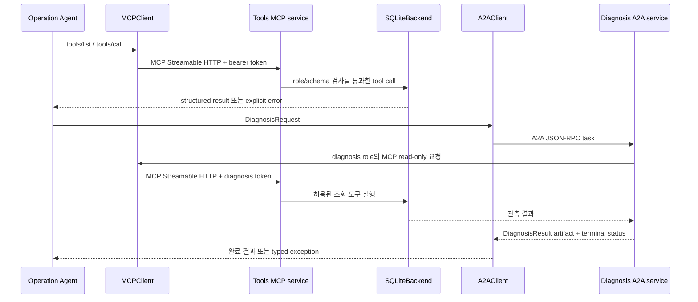

# MCP와 A2A 프로토콜 경계

이 코드는 MCP/A2A처럼 보이기만 하는 자체 JSON endpoint를 정의하지 않습니다. 고정된 SDK `mcp==2.2.0`, `a2a-sdk==1.1.5`를 사용하고, SDK가 담당하는 HTTP/wire 형식과 Testbed의 callback 로직을 분리합니다. 처음 읽는다면 [프로토콜 package 안내](../src/ccs/protocols/README.md)를 먼저 보세요.

## 용어 먼저 보기

| 용어 | 쉽게 말하면 | 이 프로젝트에서 |
|---|---|---|
| MCP | Agent가 도구를 나열하고 이름과 JSON 인자로 실행하는 프로토콜 | Agent ↔ Network Tools service, Streamable HTTP transport |
| A2A | 한 Agent가 다른 Agent에게 task를 맡기고 완료 artifact를 받는 프로토콜 | Operation → Diagnosis, A2A JSON-RPC task |
| bearer token | 요청 주체를 구분하는 비밀 문자열 | 로컬 child process에 실행별로 전달, 서버가 token으로 역할 판별 |
| callback / handler | protocol endpoint가 실제 기능을 수행할 때 부르는 사용자 코드 | MCP callback이 backend, A2A callback이 Diagnosis Agent 실행 |
| wire task ID | A2A SDK가 네트워크 task를 식별하는 ID | SDK가 발급하며, payload 안의 NetOps `task_id`와는 다른 값 |
| `ProtocolError` | protocol 경계가 호출자에게 전달하는 base exception | 인증, tool 거부, transport, A2A terminal 실패를 구분 |

## Agent 간 요청 방향



두 protocol은 방향과 역할이 다릅니다. MCP는 도구를 호출하며, A2A는 Diagnosis 작업을 위임합니다. A2A 요청 데이터에 agent가 도구 호출을 직접 넣는 구조가 아닙니다. Diagnosis의 도구 접근은 별도 MCP client/token과 role별 schema를 거칩니다.

## MCP 2.2.0 Streamable HTTP

### 서버 만들기

```python
build_mcp_app(
    schemas_by_role: Mapping[str, Sequence[dict]],
    tokens: Mapping[str, str],
    handler: Callable[[str, dict, dict], Awaitable[dict]],
    *,
    path: str = "/mcp",
) -> Starlette
```

- `schemas_by_role`에는 정확히 `operation`, `diagnosis` role별 tool schema 목록을 넣습니다.
- `tokens`는 그 role에 대응하는 bearer token map입니다. 실제 endpoint는 각 HTTP 요청에서 token을 확인하고, token에서 role을 정합니다.
- `handler(tool_name, arguments, metadata)`는 schema/role 검사 후에만 실행됩니다. protocol layer는 SQLite나 Agent 구현을 직접 import하지 않습니다.
- `path`가 기본 endpoint path `/mcp`입니다. Runner가 child app을 Uvicorn으로 실행합니다.

도구 schema는 MCP SDK의 tool list 형식에 맞춰 이름, 설명, JSON Schema parameter를 제공합니다. 예:

```json
{
  "name": "get_config",
  "description": "Read selected configuration values.",
  "parameters": {
    "type": "object",
    "properties": {"target": {"type": "string"}},
    "required": ["target"],
    "additionalProperties": false
  }
}
```

`diagnosis`에게는 read-only tool만 나열하고, `operation`에는 읽기 및 변경 도구를 나열합니다. 서버는 list response만 믿지 않고 `tools/call` 때 role lookup과 JSON Schema 검증을 반복합니다. 따라서 Diagnosis가 감춰진 `apply_change` 이름을 추측해도 실행되지 않습니다.

### Client 호출

```python
client = MCPClient(
    url,
    token,
    timeout_seconds=15.0,
    http_client=None,
)

schemas = await client.list_tools()
result = await client.call(
    tool="get_config",
    arguments={"target": "HOST-001"},
    metadata={"trace_id": "trace-123"},
)
```

실제 생성자의 `http_client`는 선택형 `httpx2.AsyncClient`입니다. 이 client는 한 번에 하나의 method request를 수행하며, method마다 stateless MCP session을 초기화합니다. MCP 2.x transport에서 쓰는 `httpx2`는 A2A가 사용하는 `httpx` Python package와 다릅니다.

Server handler로 들어오는 metadata의 모양은 다음과 같습니다.

```python
await handler(
    tool_name,
    arguments,
    {
        **client_meta,
        "protocol": "mcp",
        "role": "operation" | "diagnosis",
        "protocol_call_id": "...",
    },
)
```

`role`, `protocol`, `protocol_call_id`는 서버가 설정합니다. Client metadata는 인증된 role을 덮어쓸 수 없습니다. Handler가 돌려준 dictionary는 MCP `structuredContent`와 JSON text로 전달됩니다. Tool service의 `_ccs_event_id`처럼 event linkage에 쓰는 result field는 그대로 보존되며, 호출자 gateway가 소비한 뒤 Agent payload에서 제거할 수 있습니다.

## A2A Diagnosis task

### Server와 client API

```python
build_a2a_app(
    url: str,
    token: str,
    handler: Callable[[dict, dict], Awaitable[dict]],
    *,
    rpc_path: str = "/a2a",
    timeout_seconds: float = 30.0,
) -> Starlette

client = A2AClient(
    url,
    token,
    timeout_seconds=30.0,
    http_client=None,  # optional httpx.AsyncClient
)

result = await client.diagnose(payload, metadata={"trace_id": "trace-123"})
```

`url`에는 server의 공개 origin/base를 넣습니다. 예를 들어 `http://127.0.0.1:8102`이고 RPC 경로 `/a2a`는 SDK가 붙입니다. SDK server는 실제 A2A `AgentCard`를 `/.well-known/agent-card.json`에 공개하고 bearer authentication을 광고합니다. Card discovery는 공개지만 task operation은 bearer token이 필요합니다.

### 요청과 응답 순서

1. `A2AClient.diagnose`는 입력을 `DiagnosisRequest` contract로 검증합니다. unknown fields는 거부됩니다.
2. client는 JSON `DataPart` 하나를 보내고 SDK의 task stream을 기다립니다.
3. Diagnosis executor는 submitted `Task`와 working `TaskStatusUpdateEvent`를 보냅니다.
4. Diagnosis callback이 성공하면 `DiagnosisResult`를 `TaskArtifactUpdateEvent`에 담고 completed terminal status를 보냅니다. 실패·timeout은 failed terminal status입니다.
5. client는 terminal 결과를 contract에 맞는 dictionary로 반환합니다. 성공이 아닌 terminal state는 `A2ATaskError`, HTTP/wire 교환이 완료되지 않는 문제는 `ProtocolTransportError`입니다.

payload의 `DiagnosisRequest.task_id`는 NetOps 도메인 task ID입니다. 새 요청의 실제 wire task ID는 A2A SDK가 발급합니다. 둘을 혼동하거나 client가 임의로 미지의 wire task ID를 지정하면 `TaskNotFound`가 날 수 있습니다. callback metadata는 둘을 구분합니다.

```python
{
    **request_meta,
    "protocol": "a2a",
    "a2a_task_id": "SDK-generated task ID",
    "task_id": "DiagnosisRequest.task_id",
    "trace_id": "...",
    "message_id": "...",
    "idempotency_key": "...",
}
```

Idempotency는 Diagnosis process가 살아 있는 동안 보장됩니다. 같은 key와 canonical payload를 동시 또는 나중에 보내면 callback 하나와 같은 결과를 공유합니다. 같은 key에 다른 payload를 보내면 A2A task가 실패합니다. 이 보장은 process lifetime 경계를 넘는 영구 중복방지 DB를 뜻하지 않습니다.

## 인증과 제한

- `_auth.BearerTokenMiddleware`는 SDK route로 들어가기 전에 알 수 없는 bearer token을 거부합니다. role은 서버 token mapping으로 계산합니다.
- MCP에는 `operation`, `diagnosis` 두 service token이 필요하며 server는 각 요청 role을 재확인합니다. Diagnosis는 MCP read-only 도구만 사용합니다.
- A2A task route는 Operation→Diagnosis token으로 보호하고, agent card discovery path만 공개입니다.
- 현재 토큰은 Runner가 관리하는 로컬 child process에 ephemeral input으로 전달됩니다. protocol 모듈이 provider API key나 SQLite DB를 읽지 않습니다.
- 기본 예제는 loopback/local child service입니다. 이 구현을 외부 공개용 network perimeter, TLS 종료, production credential vault로 간주하면 안 됩니다.

## 오류를 해석하기

| 예외 | 발생 위치와 뜻 |
|---|---|
| `ProtocolAuthenticationError` | remote endpoint가 configured bearer token을 거부함 |
| `ProtocolCallError` | remote MCP tool이 명시적 tool error를 반환함 |
| `ProtocolTransportError` | HTTP/protocol 교환이나 timeout을 완료하지 못함 |
| `A2ATaskError` | transport는 됐지만 A2A task가 non-success terminal status로 끝남 |
| `ProtocolError` | 위 protocol 오류들의 공통 base class |

Agent가 요청한 값/도구가 유효하지 않은 것과 네트워크 transport가 실패한 것은 복구 방법이 다릅니다. Tool error는 입력/schema/현재 backend 상태를 읽고, Authentication은 token 설정과 service 역할을 확인하며, Transport는 child process 상태·port·timeout을 확인합니다. `ProtocolTransportError`를 이유 없이 다른 provider나 protocol로 자동 전환하지 않습니다.

## 실제 child service와 검증 범위

`ccs.services.main()`에서 `kind=tools`이면 `SQLiteBackend`, `tool_schemas`, `build_mcp_app`을 이어 붙입니다. `kind=diagnosis`이면 `InstrumentedTools`, `agent_runtime.diagnose`, `build_a2a_app`을 이어 붙입니다. `processes.Services`는 각 app을 Uvicorn으로 별도 child process에서 시작하고 run 종료 시 정리합니다. [Backend 계약](BACKEND.md)과 [프로토콜 package README](../src/ccs/protocols/README.md)에서 구현 관계를 따라갈 수 있습니다.

Protocol tests는 pinned SDK route/client를 ASGI HTTP transport로 검사하므로 유료 LLM API 호출 없이 role별 tool list, 거부, metadata, AgentCard, task lifecycle, idempotency, timeout, bad token을 확인할 수 있습니다. 별도 root integration 검사에서는 세 OS process 간 TCP 경계를 확인합니다. 테스트 통과는 localhost 기반 protocol 계약 증거이며, 외부 network 운영 검증이나 production 보안 인증을 뜻하지 않습니다. 최신 검증 범위는 [VALIDATION](VALIDATION.md), 알려진 한계는 [STATUS](STATUS.md)를 확인하세요.
