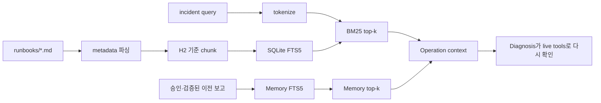

# Knowledge 검색과 Incident Memory

이 폴더는 Operation Agent가 참고하는 Markdown runbook 원문을 보관합니다. 런타임 검색 코드는 [`src/ccs/knowledge/stores.py`](../src/ccs/knowledge/stores.py)에 있으며, [기능별 Python 함수 목록](../docs/reference/python_functions.md#module-ccs-knowledge-stores)에서 함수 단위 설명을 볼 수 있습니다.

## 두 저장소를 구분하기

| 종류 | 원문/생성 시점 | 검색 방식 | 이번 기본선(D0)의 의미 |
|---|---|---|---|
| Runbook | Git에 포함된 `runbooks/*.md`; 실행 시작 때 SQLite FTS5 인덱스를 다시 만듦 | 검색 질의를 토큰화하고 BM25 점수순으로 상위 `runbook_k` 조각 반환 | 운영 절차를 찾는 지식 기반. 현재 상태를 증명하지 않으므로 Diagnosis는 도구로 재확인해야 함 |
| Incident Memory | 앞선 episode에서 검증되고 운영자 승인된 보고를 실행별 SQLite DB에 기록 | 별도 FTS5 인덱스에서 BM25 검색 | 같은 run의 뒤 episode가 참조할 수 있는 과거 사례. D0에서는 저장 eligibility를 강제하지만 읽기 시 tenant/scope/expiry 필터가 적용되지 않음 |



## Runbook 파일 형식

각 문서는 맨 처음에 YAML 비슷한 front matter를 두고, 그 뒤에 Markdown 본문을 씁니다. 파서는 범용 YAML parser가 아니라 `key: value` 한 줄씩 읽는 작은 파서입니다. 필수 키는 `doc_id`, `version`, `tenant`, `classification`, `source`이고, 현재 허용된 `classification`은 `public`, `internal`, `restricted`입니다. 닫는 `---` 뒤의 본문은 비어 있으면 안 됩니다. `doc_id`는 전체 폴더에서 중복되면 안 됩니다.

```markdown
---
doc_id: RB-W4-BANDWIDTH-CAP
version: "1.0"
tenant: common
classification: internal
source: CCS synthetic wired operations handbook
---
# 제목
내용...
```

이 형식은 `knowledge/runbooks/README.md`에서 문서별 의미와 작성 규칙을 설명합니다. 본문은 영문으로 작성되어 있고, `## ` (level-two) heading 경계마다 chunk로 나뉩니다. 각 chunk 앞에 문서의 title line이 다시 붙어서 문맥을 유지합니다. 본문에 level-two 제목이 없으면 전체 본문이 하나의 조각입니다. 조각 식별자는 `doc_id:001`, `doc_id:002`처럼 만들어집니다.

## FTS5와 BM25가 실제로 하는 일

- 질의는 case-fold 처리 후 영문·숫자·Unicode 단어를 추출합니다. 하이픈/점이 붙은 토큰(예: `HOST-001`, `loss_pct`)은 한 토큰으로 보존될 수 있습니다. 각 토큰은 최대 64자, 질의는 최대 32개 토큰입니다.
- 토큰은 FTS5의 `porter unicode61` tokenizer로 색인/검색됩니다. 질의의 각 토큰은 안전하게 따옴표 처리된 `OR` 검색식이 됩니다. 빈 토큰 질의는 오류가 아니라 결과 `[]`입니다.
- SQLite `bm25(...)`는 일치 결과의 relevance score를 반환하며, 구현은 **작은 점수를 먼저** 정렬합니다. 점수가 확률이나 성공 가능성은 아닙니다. 동점은 `doc_id`, `chunk_id` 순으로 결정됩니다.
- `k`는 positive integer여야 합니다. 0, 음수, bool, 문자열은 거부됩니다.
- Runbook 인덱스는 실행 시 checked-in 문서를 훑어 재생성합니다. Memory 인덱스는 run-local이며 기록 시 일반 테이블과 FTS 테이블을 함께 갱신합니다.

검색 결과는 단서일 뿐입니다. runbook의 원인·target·수치가 현재 상황과 일치한다고 가정해서는 안 됩니다. 현재 alarm/config/KPI/topology는 Diagnosis가 read-only MCP 도구로 관찰한 값을 기준으로 결정합니다.

## `Memory OFF`와 빈 Memory는 다릅니다

- **Memory OFF**: 설정 `memory_enabled=false`인 조건입니다. Memory 검색/전달 기능을 비활성화합니다. Runbook RAG는 별도 기능이므로 계속 켜져 있을 수 있습니다.
- **Memory ON + 0 records**: 검색 기능은 켜져 있지만 조회할 저장 이력이 없습니다. 검색 결과가 비어 있다는 상태를 의미합니다.
- **Memory ON + 결과 없음**: 레코드가 존재해도 현재 검색 질의와 일치하는 내용이 없을 수 있습니다.
- **Memory ON + 결과 있음**: 같은 run 앞 episode에서 등록된 Memory를 context로 보낼 수 있습니다. 이것은 기록의 모든 필드가 현재 사건에 해당한다는 뜻이 아닙니다.

이 구분은 pair 실험과 실행 manifest를 해석할 때 중요합니다. 실험 조건은 문서 [runtime conditions](../docs/INSTRUMENTATION.md) 및 [실행 상태](../docs/STATUS.md)와 대조하세요. 현재 구현은 보호 효과나 scope/expiry 필터링을 뜻하지 않습니다.

## 구현을 읽는 순서

1. 이 README로 Runbook과 Memory의 역할을 나눕니다.
2. [`runbooks/README.md`](runbooks/README.md)와 6개 문서에서 검색 가능한 지침을 확인합니다.
3. [`src/ccs/knowledge/stores.py`](../src/ccs/knowledge/stores.py)의 `_parse_runbook`, `_chunks`, `RunbookStore.search`, `MemoryStore.search`를 따라갑니다.
4. `tests/test_instrumentation.py`의 FTS/BM25 및 Memory 검사, `tests/test_runtime_conditions.py`의 runbook 선택·Memory provenance 검사로 계약을 확인합니다. 전체 테스트 색인은 [`tests/README.md`](../tests/README.md)입니다.

