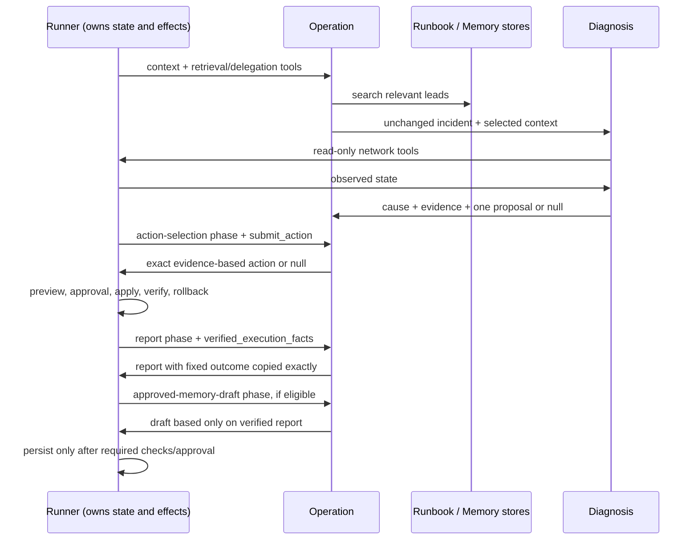

# Agent prompts

이 폴더의 두 파일은 영어로 된 Operation/Diagnosis 역할 지침입니다. `src/ccs/agent_runtime.py`에서 각 Agent의 시스템 지침으로 읽히며, `src/ccs/runner.py`가 매 phase에 필요한 입력과 offered tools를 구성합니다. 프롬프트는 실행 흐름 전체를 소유하지 않습니다. Runner는 tool availability, state machine, approval, apply, verify, rollback과 Memory persistence를 코드 계약으로 강제합니다.

## 2개 prompt

- [`operation.txt`](operation.txt): 운영 조정자입니다. incident context에서 Runbook/승인된 Memory 검색 후 Diagnosis에 위임하고, 근거를 받은 뒤 action을 제출하며, 실행 사실 기반 report와 Memory draft를 작성합니다.
- [`diagnosis.txt`](diagnosis.txt): 증상 원인 분석자입니다. read-only 도구로 alarm, host config, KPI 및 필요한 경우 topology/flow를 읽습니다. Runbook·history는 현재 사실로 취급하지 않으며, 지원되는 root-cause와 evidence-based 단일 제안 또는 `null`을 내놓습니다.

## Operation phase별 계약

1. **`context`** — 관련 runbook과 approved incident memory를 검색해 선별합니다. Diagnosis에 incident 입력을 변경 없이 전달합니다. Memory가 OFF이거나 결과가 0이면 전달할 Memory가 없지만 두 상태 의미는 다릅니다(상세는 [`knowledge/README.md`](../knowledge/README.md#memory-off와-빈-memory는-다릅니다)).
2. **`action_selection`** — Diagnosis의 현재 관측과 supported proposal을 바탕으로 `submit_action`을 한 번 호출합니다. 정확한 target/field/value가 관측치에 없거나 원인 불명, no fault, 모순/불충분 증거면 null을 제출합니다.
3. **`report`** — Runner가 준 `verified_execution_facts`에서 `outcome`을 그대로 복사합니다. `RECOVERED`이며 `verify.passed=true`인 경우만 recovery를 주장합니다. Preview/proposal은 적용이 아닙니다.
4. **`approved_memory_draft`** — 검증된 report 사실만으로 draft를 제출합니다. 제안은 저장 확인이 아닙니다. 쓰기 eligibility와 실제 영속화는 Runner 쪽에서 통제합니다.

## Diagnosis가 지키는 현재 지침

Diagnosis는 incident/runbook/history를 실제 네트워크 상태로 여기지 않습니다. 우선 정확한 host의 alarms/config/KPI를 읽고, topology가 필요하면 실제 선택 경로와 대체 경로 전부를 검증합니다. Flow 조회는 host/src/dst 근거가 필요할 때만 사용합니다. 읽기 실패도 tool budget을 소비하며, 같은 읽기는 근거 없이 반복하지 않습니다. W2-W5는 실제 관측한 current/reference 비교에서 정확한 field/value를 제시하고, N0 또는 unknown이면 change를 내지 않습니다.

## 바꾸기 전에 확인할 것

- Prompt tool 이름과 schema는 `contracts.py`, `tool_access.py`, `agent_runtime.py`와 동기화되어야 합니다.
- 프롬프트는 Diagnosis가 정책 판단의 근거를 만들어내거나 Runner가 맡은 부작용을 대신 수행한다고 쓰면 안 됩니다.
- 사용자 증상이나 Runbook의 사례 문구를 숨은 scenario label/ground truth처럼 취급하면 안 됩니다.
- 시스템 prompt 텍스트를 수정하면 mock regression과 provider-contract 영향 범위를 확인하고 [테스트 색인](../tests/README.md) 및 [현재 검증 범위](../docs/VALIDATION.md)를 검토합니다.
- 실험 보고는 prompt/code/config/source snapshot을 함께 고정해야 합니다. 문장 가이드의 수정만으로 실제 Agent 진단 품질이나 성공률 개선이 입증되지는 않습니다.
