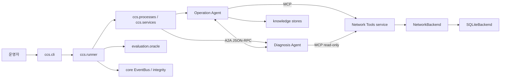

# Python 소스 시작 안내

`src/`는 import 가능한 Python 패키지의 부모 디렉터리입니다. 여기에는 실행 진입점이 직접 놓여 있지 않고, 실제 프로그램은 `ccs` 패키지 안에 있습니다. 초보자는 먼저 [패키지 전체 안내](ccs/README.md)를 읽고, 이후 관심 기능에 맞춰 하위 패키지 안내를 따라가면 됩니다.

## 어디서부터 읽을까요?

| 알고 싶은 것 | 다음 문서 |
|---|---|
| CLI에서 실행이 시작되고 Agent들이 일하는 전체 순서 | [ccs/README.md](ccs/README.md) |
| 결정론적 장애 상황 만들기 | [bench/README.md](ccs/bench/README.md) |
| 공개량 계측, 이벤트 저장, 파일 무결성 | [core/README.md](ccs/core/README.md) |
| ground truth와 분리된 성공 판정, 공개량 장부 | [evaluation/README.md](ccs/evaluation/README.md) |
| Runbook·Memory 검색과 저장 | [knowledge/README.md](ccs/knowledge/README.md) |
| Network Tool과 SQLite 합성망 | [netops/README.md](ccs/netops/README.md) |
| MCP/A2A 통신 경계 | [protocols/README.md](ccs/protocols/README.md) |

## Python import 경로

프로젝트 루트에서 `ccs`를 찾으려면 `src`가 Python import 경로에 포함되어야 합니다. 제공된 `ccs.ps1`과 `setup.ps1`이 프로젝트 실행 환경을 준비합니다. 직접 Python을 호출할 때는 `PYTHONPATH=src`를 지정하거나, 설치된 환경에서 `python -m ccs`를 실행합니다. `ccs/__main__.py`가 `ccs.cli.main()`으로 연결됩니다. Mutable local data의 working/web 기본 경로와 `CCS_WORKING_ROOT`, `CCS_WEB_WORKSPACE` 재정의는 [`ccs/paths.py`](ccs/paths.py)에서 확인하세요.

이 폴더의 `__pycache__/`는 Python이 생성한 bytecode cache이며 사람이 편집하는 소스가 아닙니다. Git ignore 규칙에 따라 캐시 파일은 저장소에 포함하지 않습니다.

## 코드 역할을 따라가기

프로그램의 대표 흐름은 다음과 같습니다. 화살표는 데이터·제어 흐름의 큰 경계를 나타내며, 모든 함수 호출을 빠짐없이 그린 call graph는 아닙니다.

실행 UI의 정적 화면 구성은 `ccs.studio_markup`, `ccs.studio_script`, `ccs.studio_styles`에 있고, HTTP 요청·실험 상태 관리는 `ccs.web_console`에 있습니다. CLI 모니터와 읽기 전용 실행 분석은 각각 `ccs.monitor`와 `ccs.run_analysis`에 있습니다.

> **범위 주의:** 이 소스는 SQLite 기반 합성 유선망의 D0 baseline입니다. `core.gateway.NullGate`는 입력을 바꾸지 않고 허용하는 계측 지점입니다. 문서상 G1/G2/G3/G4/G5/G6 이름이 있다고 보호 기능이 구현된 것은 아닙니다. Mininet은 실제 `SQLiteBackend` 실행 경로가 아니며 별도 계획/검증 범위입니다.

다른 모듈 사이의 payload/API 약속은 [모듈 계약 지도](../docs/MODULE_CONTRACTS.md)에서 확인하세요. 실행 중 event·Runbook·Memory 내용을 더 깊이 읽을 때는 [계측과 검색 안내](../docs/INSTRUMENTATION.md)를 참고합니다.
