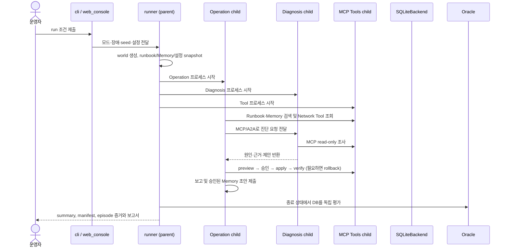

# `ccs` Python 패키지 안내

이 패키지는 합성 유선 NetOps 환경에서 Operation Agent와 Diagnosis Agent가 협력하는 D0 baseline입니다. 이 문서는 파일 지도를 제공하고, 전체 함수·메서드 목록과 정의는 [Python 함수 참조](../../docs/reference/python_functions.md)를 사용합니다. 각 표의 **함수 참조**는 그 파일의 catalog 항목으로 이동합니다.

## 탐색 경로

- [소스 트리 진입점](../README.md)
- [초보자 빠른 시작](../../docs/QUICKSTART.md), [전체 프로젝트 상태](../../docs/STATUS.md)
- [웹 콘솔 사용법](../../docs/WEB_CONSOLE.md), [Backend 계약](../../docs/BACKEND.md), [MCP/A2A 프로토콜](../../docs/PROTOCOLS.md), [계측·Runbook·Memory](../../docs/INSTRUMENTATION.md), [모듈 계약 지도](../../docs/MODULE_CONTRACTS.md)
- 하위 구현: [bench](bench/README.md) · [core 계측](core/README.md) · [evaluation](evaluation/README.md) · [knowledge](knowledge/README.md) · [netops backend](netops/README.md) · [protocols](protocols/README.md)

## 먼저 알아둘 것

- `python -m ccs`는 [`__main__.py`](__main__.py)에서 [`cli.main`](../../docs/reference/python_functions.md#fn-ccs-cli-main)으로 연결됩니다. `ccs.ps1`은 이 프로젝트의 Windows 실행 편의 wrapper입니다. local mutable 작업 데이터 경로 기본값과 환경변수 재정의는 [`paths.py`](paths.py)의 `working_root()`와 `web_workspace()`에서 정합니다.
- 기본 `run` 모드는 `mock`입니다. 외부 유료 API 요청은 `--mode live`로 명시해야 합니다. `doctor`, `costs`, `budget`, `report`, `compare`는 각각 별도 목적의 명령입니다.
- 이 Testbed의 망은 에피소드마다 만든 SQLite DB입니다. `NetworkBackend`는 도구와 backend 사이의 안정된 인터페이스이며, 구현체는 현재 `SQLiteBackend`입니다.
- `evaluation.oracle`은 실제 DB 최종 상태와 시나리오의 평가용 정답을 비교합니다. Agent가 작성한 보고 문장을 정답으로 취급하지 않습니다.
- `core`의 `NullGate`는 D0 관측용 pass-through입니다. 보호 정책·마스킹 효과가 켜졌다는 의미가 아닙니다.

## 한 건의 실행 흐름

이 다이어그램은 컴포넌트 간 흐름을 보여 줍니다. 내부 retry, schema repair, event/activity 기록을 모든 세부 단계까지 표현한 것은 아닙니다.

### 초보자용 실행 순서

1. 프로젝트 루트 `04.Testbed`에서 `.\ccs.ps1 doctor`를 실행해 XML 설정과 필수 패키지가 읽히는지 확인합니다. 이 명령은 모델 API 호출을 하지 않습니다.
2. 무료 경로를 익히려면 `.\ccs.ps1 run --mode mock --faults W4 --seeds 1`을 사용합니다. Mock은 공급사 API 대신 결정론적 모델 응답을 사용하되, 별도 프로세스와 MCP/A2A 경계는 실행합니다.
3. 호출 흐름을 보고 싶으면 같은 명령에 `--dashboard`를 추가합니다. 상세 CLI 활동은 `--progress detailed`로 볼 수 있습니다. 사용 중인 포트가 막혀 웹 서버 bind가 실패하면 `--port 0` 또는 다른 사용 가능 포트를 선택합니다.
4. 실제 모델을 시험하려면 `--mode live`를 명시하고, 먼저 예산·profile·API key 설정을 점검합니다. Provider나 예산 오류는 오류 상태와 실행 증거로 남으며 자동으로 다른 모델로 전환되지 않습니다.
5. 종료 후 Oracle의 실제 성공 여부와 run integrity를 따로 확인합니다. `COMPLETED`는 실행기가 끝났다는 뜻이고 그 자체만으로 복구 성공을 보장하지 않습니다. `report <run_dir>`은 seal을 확인하며, `compare`는 복수 실행의 조건·비용·결과를 비교합니다.

명령별 인자, 결과 폴더, API/key 보호는 프로젝트 루트 [README](../../README.md)의 `실행`, `설정 파일`, `비용 조정`, `결과 읽기` 절을 기준으로 하세요. 이 README는 새로운 실험을 실행하도록 요구하지 않습니다.

## 폴더별 구현

| 하위 폴더 | 책임 / 주 진입점 |
|---|---|
| [`bench/`](bench/README.md) | [`create_world`](../../docs/reference/python_functions.md#fn-ccs-bench-scenarios-create_world)가 seed·장애·난이도 조건으로 새 SQLite 세계와 evaluator 전용 scenario metadata를 생성합니다. |
| [`core/`](core/README.md) | `Gateway` pass-through, 프로세스별 append-only `EventBus`, 엄격한 `DisclosureEvent`, seal 전 integrity 확인과 causal merge. |
| [`evaluation/`](evaluation/README.md) | [`evaluate`](../../docs/reference/python_functions.md#fn-ccs-evaluation-oracle-evaluate)는 독립 복구 판정, [`build_ledger`](../../docs/reference/python_functions.md#fn-ccs-evaluation-ledger-build_ledger)는 민감 항목의 출처 추적을 구성합니다. |
| [`knowledge/`](knowledge/README.md) | SQLite FTS5/BM25 Runbook 검색과 episode 간 승인 Memory 저장·조회. |
| [`netops/`](netops/README.md) | backend-neutral Network Tool 계약 및 SQLite 기반 wired 상태·change lifecycle. |
| [`protocols/`](protocols/README.md) | token-auth MCP와 A2A JSON-RPC adapter/client. 실제 child service의 HTTP 경계입니다. |

## 패키지 직속 파일 지도

파일 이름을 누르면 현재 소스로 이동합니다. **함수 참조**에서 각 함수·메서드의 전체 목록과 역할을 확인할 수 있습니다. 내부 모듈명은 Python의 dotted module name이며 `ccs.`부터 표시합니다.

| 파일 | 초보자용 역할, 연결 지점 | 함수 참조 |
|---|---|---|
| [`__init__.py`](__init__.py) | 패키지 설명. 별도 실행 동작은 없습니다. D0 보호 기능이 없다는 범위 표시를 포함합니다. | [module](../../docs/reference/python_functions.md#module-ccs-__init__) |
| [`__main__.py`](__main__.py) | `python -m ccs` 진입점. CLI의 `main()`으로 넘깁니다. | [module](../../docs/reference/python_functions.md#module-ccs-__main__) |
| [`agent_runtime.py`](agent_runtime.py) | Agent 단계별 추론을 담습니다. `collect_context`는 Operation의 검색·위임 입력을 만들고, `diagnose`, `select_change`, `compose_report`, `propose_memory`는 Diagnosis/Operation 결과 단계를 처리합니다. `prompt`, `call_model`은 prompt 조립과 schema 기반 모델 호출 경계입니다. | [module](../../docs/reference/python_functions.md#module-ccs-agent_runtime) |
| [`budget.py`](budget.py) | 정수 nano-USD 기준의 누적 비용 원장. `token_cost`, `BudgetLedger.reserve/settle/summary`가 호출 전 예약, 사용량 정산, 현재 장부 조회를 담당합니다. 초과 예약은 `BudgetExceeded`입니다. | [module](../../docs/reference/python_functions.md#module-ccs-budget) |
| [`cli.py`](cli.py) | 사용자 명령 parser와 command dispatch. `parser`가 명령/옵션을 정의하고 `main`이 web, run, monitor, report, compare, doctor, costs, budget을 해당 모듈로 전달합니다. 예상 가능한 설정·입력 실패와 실행 실패를 구분한 종료 코드를 반환합니다. | [module](../../docs/reference/python_functions.md#module-ccs-cli) |
| [`config.py`](config.py) | XML 스키마 검증 및 AI/system 설정 로딩. `load_ai`, `load_system`이 중복·미지원 항목과 잘못된 값을 검사하고, `AIConfig.profile`에서 실행 역할에 맞는 profile을 고릅니다. 설정 오류는 `ConfigurationError`입니다. | [module](../../docs/reference/python_functions.md#module-ccs-config) |
| [`contracts.py`](contracts.py) | Provider와 독립된 Pydantic data contract: `DiagnosisRequest/Result`, `ProposedChange`, `Report`, `MemoryRecord`. `extra="forbid"`로 선언되지 않은 필드를 거부합니다. | [module](../../docs/reference/python_functions.md#module-ccs-contracts) |
| [`event_communication.py`](event_communication.py) | 이미 safe projection 된 activity event의 통신 방향·payload 표시를 구성합니다. restricted provider transcript를 직접 읽지 않습니다. | [module](../../docs/reference/python_functions.md#module-ccs-event_communication) |
| [`event_presentation.py`](event_presentation.py) | activity event를 UI topology route, actor, node 단계, 한·영 headline으로 변환하는 표시 전용 계층입니다. 저장 원본 JSONL은 수정하지 않습니다. | [module](../../docs/reference/python_functions.md#module-ccs-event_presentation) |
| [`llm.py`](llm.py) | OpenAI Responses와 Anthropic Messages API adapter. `Conversation.next`가 tool/schema 제약을 적용하고, `feedback`/`result`가 대화에 결과를 연결합니다. `ProviderError`와 `ProviderSchemaError`는 공급사/응답 문제를 나타냅니다. | [module](../../docs/reference/python_functions.md#module-ccs-llm) |
| [`monitor_i18n.py`](monitor_i18n.py) | 독립 activity monitor의 고정 UI 문구를 한국어와 English로 제공합니다. 판단 로직이나 실행 증거를 바꾸지 않습니다. | [module](../../docs/reference/python_functions.md#module-ccs-monitor_i18n) |
| [`monitor.py`](monitor.py) | curated `activity/*.jsonl`과 제한된 manifest/summary 필드만 읽는 로컬 monitor. `read_activity`/`write_snapshot`은 화면용 snapshot을 만들고 `DashboardServer`는 읽기 전용 HTTP 화면을 제공합니다. | [module](../../docs/reference/python_functions.md#module-ccs-monitor) |
| [`network_view.py`](network_view.py) | operator UI용 읽기 projection. `preview_network`는 결정론적 시작 상태를, `read_network`는 episode의 선택된 최종 상태를 읽습니다. SQLite를 read-only로 열고 결과 파일을 고치지 않습니다. | [module](../../docs/reference/python_functions.md#module-ccs-network_view) |
| [`observability.py`](observability.py) | 사람이 볼 수 있게 의도적으로 넘긴 세부정보만 scrub해 append-only JSONL activity로 저장합니다. `ActivityLog.emit`은 운영 화면 활동이며 `core.EventBus` disclosure audit와 다른 산출물입니다. | [module](../../docs/reference/python_functions.md#module-ccs-observability) |
| [`pacing.py`](pacing.py) | 프로세스가 공유하는 실행 지연 제어와 각 run의 delay accounting. `write_control`, `wait_after_event`, `summarize_timing`이 제어 변경, 이벤트 뒤 대기, 겹친 시간 합산을 담당합니다. | [module](../../docs/reference/python_functions.md#module-ccs-pacing) |
| [`paths.py`](paths.py) | `PROJECT_ROOT`, `working_root()`, `web_workspace()`가 subprocess 작업 데이터와 웹 library/index의 portable 기본 경로를 계산합니다. `CCS_WORKING_ROOT`, `CCS_WEB_WORKSPACE` 환경변수로 재정의하며, 경로 조회 과정에서 폴더를 생성하지 않습니다. 명령의 명시적 `--workspace`가 있으면 그 선택이 우선입니다. | [module](../../docs/reference/python_functions.md#module-ccs-paths) |
| [`processes.py`](processes.py) | 로컬 child service의 포트 선택, startup/cleanup을 관리합니다. `Services` context manager를 벗어나면 정상·오류 경로 모두 프로세스 정리를 시도합니다. | [module](../../docs/reference/python_functions.md#module-ccs-processes) |
| [`progress.py`](progress.py) | 공유 activity stream을 읽어 CLI에 간단/상세 진행을 투영합니다. `ConsoleProgress`는 실행 기록을 새로 만들지 않습니다. | [module](../../docs/reference/python_functions.md#module-ccs-progress) |
| [`reporting.py`](reporting.py) | 완료 run의 HTML/Markdown/JSON 요약, artifact seal 검사와 조건 기반 run 비교를 담당합니다. `verify_seal`의 무결성 통과와 Oracle 복구 성공은 서로 다른 질문입니다. | [module](../../docs/reference/python_functions.md#module-ccs-reporting) |
| [`run_analysis.py`](run_analysis.py) | 보관된 완료 run을 결정론적으로 읽어 한정된 결과 분석을 생성합니다. `analyze_run`은 선택된 manifest/summary/oracle/activity/network 필드만 읽으며 run artifact를 수정하지 않습니다. | [module](../../docs/reference/python_functions.md#module-ccs-run_analysis) |
| [`runner.py`](runner.py) | 전체 run/episode 조율자. `run`이 조건을 정규화하고 산출물·세계·서비스를 준비하며, `execute_episode`가 한 사건을 진행하고 `_finalize_run`이 최종 보고·seal을 관리합니다. 예외 시 실패 상태를 남기고 부분 증거를 보존합니다. | [module](../../docs/reference/python_functions.md#module-ccs-runner) |
| [`scenario_catalog.py`](scenario_catalog.py) | operator에게 보여 줄 wired-v1 시나리오 설명과 선택 정보를 제공합니다. 상태 전이는 `bench.scenarios`/backend에 있고 이 파일은 UI용 catalog입니다. | [module](../../docs/reference/python_functions.md#module-ccs-scenario_catalog) |
| [`services.py`](services.py) | `python -m ccs.services tools\|diagnosis` child-process 진입점. tools 역할에서는 SQLite backend와 MCP app을, diagnosis 역할에서는 Agent와 A2A app을 연결합니다. [프로토콜 안내](../../docs/PROTOCOLS.md) 참고. | [module](../../docs/reference/python_functions.md#module-ccs-services) |
| [`studio_markup.py`](studio_markup.py) | 웹 콘솔의 semantic HTML 구조. 동적 값은 browser script가 text node로 채웁니다. | [module](../../docs/reference/python_functions.md#module-ccs-studio_markup) |
| [`studio_script.py`](studio_script.py) | 브라우저의 탭 전환, 상태 갱신, 실행 요청과 모니터링 상호작용을 담당합니다. 모델 판단·DB 직접 수정·run 증거 재작성은 하지 않습니다. | [module](../../docs/reference/python_functions.md#module-ccs-studio_script) |
| [`studio_styles.py`](studio_styles.py) | 세 탭 NetOps Studio의 색상·간격·레이아웃을 정의합니다. 화면 표현 계층이며 Python 실행 순서를 제어하지 않습니다. | [module](../../docs/reference/python_functions.md#module-ccs-studio_styles) |
| [`tool_access.py`](tool_access.py) | Agent용 MCP client facade. `InstrumentedTools.list_tools/call`이 역할·trace/cause 메타데이터와 activity/disclosure 계측을 연결해 실제 MCP service에 요청합니다. | [module](../../docs/reference/python_functions.md#module-ccs-tool_access) |
| [`web_console.py`](web_console.py) | 웹 실행 컨트롤러와 로컬 HTTP handler. `WebConsoleServer`는 설정 검증, 입력 library freeze, `runner.run` 시작, 결과 조회·분석·stop을 관리합니다. token/host/origin 검증은 route 진입 경계에서 수행됩니다. | [module](../../docs/reference/python_functions.md#module-ccs-web_console) |
| [`web_ui.py`](web_ui.py) | `document()`가 markup, CSS, JavaScript를 한 응답 자산으로 모아 web handler에 공급합니다. 화면 자산 연결 계층입니다. | [module](../../docs/reference/python_functions.md#module-ccs-web_ui) |

## 오류와 실패를 읽는 법

- CLI의 잘못된 설정/입력은 `ConfigurationError` 또는 `ValueError` 경로에서 간결한 메시지와 종료 코드 2로 끝납니다. `KeyboardInterrupt`는 부분 run artifact를 보존한다고 알리고 130을 반환합니다.
- live provider의 timeout, schema 오류, 예산 소진은 Agent/runner가 다루는 실행 실패입니다. 다른 provider로 묵시적 재시도하지 않습니다. 오류 문구만으로 성공 여부를 판단하지 말고 run의 status, manifest, episode 결과를 확인합니다.
- 변경 작업은 `preview_change`에서 상태 version과 되돌릴 기준을 고정한 뒤 승인/apply/verify 단계를 밟습니다. 실패하면 rollback 경로가 있습니다. backend의 세부 규칙은 [Backend 계약](../../docs/BACKEND.md)과 [Network Tool 안내](netops/README.md)에 있습니다.
- `monitor.html`은 curated 활동 표시, `events/`와 `blobs/`는 restricted disclosure 증거입니다. 두 저장 영역의 목적을 혼동하지 마세요. `core/README.md`와 [실행 결과 요약](../../docs/RESULTS.md)가 구분을 설명합니다.
- 실행 완료 여부, Oracle utility, seal validity는 각각 실행계 상태·업무 결과·파일 무결성을 나타냅니다. 이 세 가지를 함께 읽어야 합니다.

