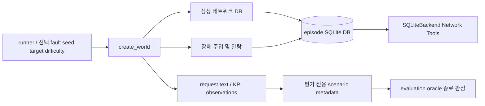

# `ccs.bench` — 결정론적 실험 세계 만들기

이 패키지는 agent가 작업을 시작하기 전, 독립된 episode용 synthetic wired world를 준비합니다. 실행 조율은 [`runner.execute_episode`](../../../docs/reference/python_functions.md#fn-ccs-runner-execute_episode)에서 시작해 [`create_world`](../../../docs/reference/python_functions.md#fn-ccs-bench-scenarios-create_world)를 호출합니다. 새 DB는 `SQLiteBackend`가 실제 MCP Network Tools 요청에 사용하는 상태이며, scenario metadata는 agent에 노출하지 않고 종료 시 평가 단계에 전달합니다.

## 데이터 흐름과 책임

`seed`가 같고 입력 조건이 같으면 scenario 생성은 결정론적입니다. `fault_id`는 wired catalog의 W1–W5 또는 N0입니다. `difficulty`는 관측에 무관한 방해 알람 수를 조절합니다. 시나리오 텍스트와 망 변화는 여기서 만들지만, agent가 어느 도구를 언제 호출할지는 이 모듈이 결정하지 않습니다.

## 폴더 내 파일

| 파일 | 역할 | 함수·메서드 참조 |
|---|---|---|
| [`__init__.py`](__init__.py) | 패키지 설명. 합성 세계 생성 함수는 [`scenarios.py`](scenarios.py)에 있습니다. | [함수 참조](../../../docs/reference/python_functions.md#module-ccs-bench-__init__) |
| [`scenarios.py`](scenarios.py) | 정상 wired topology/config/KPI 테이블 생성, 장애별 config/alarm 주입, 영어 요청 문구 및 evaluator 전용 관측 생성. 공개 진입점은 `create_world(path, seed, fault_id, target, difficulty)`입니다. | [전체 함수 참조](../../../docs/reference/python_functions.md#module-ccs-bench-scenarios) |

`scenarios.py` 안의 `_create_normal_world`, `_inject_fault`, `_observations`, `_registry`는 `create_world`를 구성하는 내부 단계입니다. `create_world` 결과 중 DB는 network service로, scenario metadata는 Oracle에서만 쓰도록 `runner.py`가 경계를 유지합니다.

## 살펴볼 순서

1. [`scenario_catalog.py`](../scenario_catalog.py): 운영자가 고르는 시나리오 이름과 의미를 확인합니다.
2. [`create_world`](../../../docs/reference/python_functions.md#fn-ccs-bench-scenarios-create_world): 선택 조건과 반환값이 어디서 만들어지는지 봅니다.
3. [NetworkBackend 설명](../netops/README.md): DB가 어떤 Network Tool 계약을 구현하는지 따라갑니다.
4. [Oracle 설명](../evaluation/README.md): scenario 정답이 왜 Agent 실행 이후에만 사용되는지 확인합니다.

실제 W1–W5/N0 정의, 성능 가설 또는 Mininet/실망 결과는 이 파일 하나에서 일반화하지 마세요. 현재 실행 backend는 SQLite 합성망이고, 실제 네트워크 검증은 별도 범위입니다.
