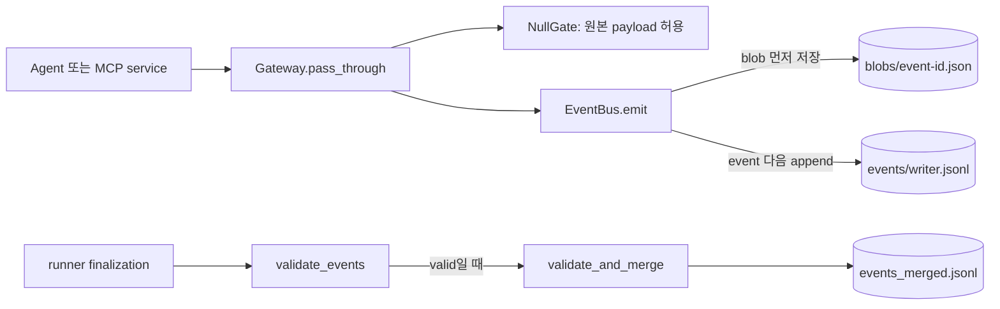

# `ccs.core` — 계측 이벤트와 무결성

`core`는 Agent/Tool 사이의 disclosure crossing을 D0에서 관측하고, 실행이 끝났을 때 기록된 파일이 기대한 형태인지 확인합니다. 이것은 운영자 화면의 로그와 별도입니다. core event는 `events/*.jsonl` 인덱스와 `blobs/*.json` 원문 payload를 포함하는 restricted 증거입니다. 일반 화면의 활동기록은 [`observability.py`](../observability.py)에서 따로 scrub·기록합니다.

## 실행 중과 종료 시 흐름

`NullGate`는 입력 객체를 복사하거나 변경하지 않고 허용합니다. 따라서 이 코드는 gateway 위치와 event를 관측하지만 disclosure filtering/mitigation 효과를 구현하지 않습니다. `Gate` Protocol은 추후 정책 지점을 위한 계약일 뿐, 정책 구현의 증거는 아닙니다.

## 폴더 내 파일

| 파일 | 역할과 중요한 동작 | 전체 함수·메서드 참조 |
|---|---|---|
| [`__init__.py`](__init__.py) | D0 primitive package 설명. | [module](../../../docs/reference/python_functions.md#module-ccs-core-__init__) |
| [`bus.py`](bus.py) | `canonical_json_bytes`로 digest 대상 byte를 안정적으로 만들고, `EventBus.emit`이 immutable payload blob을 먼저 쓴 뒤 프로세스 소유 JSONL shard에 event를 append합니다. writer/sequence 충돌이나 기존 손상 shard는 실행을 거부합니다. | [module](../../../docs/reference/python_functions.md#module-ccs-core-bus) |
| [`events.py`](events.py) | Pydantic `DisclosureEvent`의 strict schema, G1~G6 stage/status 제한, event ID·trace·transport·payload digest 참조 형태와 timestamp 검증. 실제 payload 원문은 model 필드가 아니라 blob에 있습니다. | [module](../../../docs/reference/python_functions.md#module-ccs-core-events) |
| [`gateway.py`](gateway.py) | `GateTrace`, `Gate` Protocol, `NullGate`, `Gateway`. `Gateway.pass_through(stage, payload, source, sink, ...)`가 gate 결정을 event metadata에 추가하고 event bus에 넘깁니다. | [module](../../../docs/reference/python_functions.md#module-ccs-core-gateway) |
| [`integrity.py`](integrity.py) | event JSONL/schema, 각 writer 순번, episode sequence, causal/span 연결, blob 존재·JSON·digest·size·중복·orphan, terminal request/response pair를 검사합니다. `validate_events`는 읽기 전용, `validate_and_merge`는 모든 검사가 성공한 경우에만 `events_merged.jsonl`을 씁니다. | [module](../../../docs/reference/python_functions.md#module-ccs-core-integrity) |

## 결과를 읽는 순서

1. `manifest.json`에서 run/episode terminal 상태를 확인합니다.
2. `events/` shard와 `blobs/` 참조를 `validate_events(run_dir)`로 검사합니다. 이 API는 `events_merged.jsonl`을 만들거나 고치지 않습니다.
3. 이벤트가 유효하면 `validate_and_merge(run_dir)`가 causation 및 parent-span dependency를 지키는 deterministic merge를 만듭니다.
4. `reporting.verify_seal`은 runner가 기록한 run 전체 artifact seal을 확인합니다. 이것은 core event integrity 검사와 관련은 있지만 같은 체크가 아닙니다.

잘못된 event, 누락/손상 blob, orphan blob, causation cycle, terminal MCP/A2A 요청에 응답이 한 개가 아닌 경우는 실패로 남아야 합니다. 실패한 실행도 삭제하지 말고 report 및 `docs/STATUS.md`의 상태 설명을 함께 확인하세요.

## 연결 문서

- 상위: [`ccs` 전체 실행 흐름](../README.md#한-건의-실행-흐름)
- 운영 화면 활동 로그와 차이: [`observability.py`](../observability.py), [`monitor.py`](../monitor.py)
- MCP/A2A에서 각 crossing이 만들어지는 경계: [`protocols/README.md`](../protocols/README.md)
- output directory 구조와 restricted 데이터: [실행 결과 요약](../../../docs/RESULTS.md)
