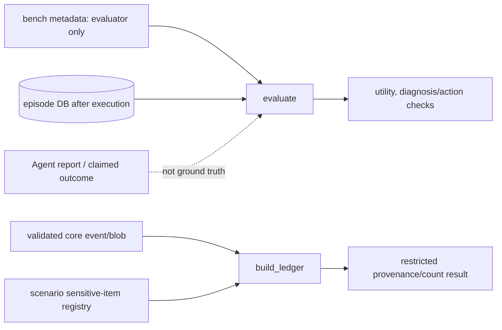

# `ccs.evaluation` — 실제 결과를 독립적으로 판단하기

Agent의 답변은 자기 자신을 채점하지 않습니다. [`oracle.py`](oracle.py)는 episode 종료 후 실제 SQLite 상태, 결정론적 service verify, 원래 scenario metadata를 사용해 업무 성공을 판정합니다. [`ledger.py`](ledger.py)는 계측 event/blob의 provenance를 통해 민감 항목이 어느 경로에서 노출됐는지 제한된 형태로 계산합니다.

## 폴더 내 파일

| 파일 | 역할 | 함수·메서드 참조 |
|---|---|---|
| [`__init__.py`](__init__.py) | 독립 평가 도구 묶음에 대한 package 설명. | [module](../../../docs/reference/python_functions.md#module-ccs-evaluation-__init__) |
| [`oracle.py`](oracle.py) | `evaluate(db_path, scenario)`가 최종 config/KPI/service verify와 보존 상태를 정답 metadata와 비교해 utility 및 진단/조치 결과를 계산합니다. LLM 보고문은 입력으로 받지 않습니다. | [module](../../../docs/reference/python_functions.md#module-ccs-evaluation-oracle) |
| [`ledger.py`](ledger.py) | `build_ledger(run_dir, registry)`가 검증할 event/blob provenance를 연결하고, exact duplicate registry binding을 정리해 민감 값의 출현 위치를 계산합니다. 결과에 raw 값이 새어 나오지 않도록 제한합니다. | [module](../../../docs/reference/python_functions.md#module-ccs-evaluation-ledger) |

## runner와의 관계

`runner.execute_episode`가 agent 작업을 수행하는 동안 scenario ground truth를 일반 Agent context에 포함하지 않습니다. episode가 terminal 상태에 도달한 뒤 Oracle에 실제 DB 경로와 evaluator-side metadata를 넘깁니다. 이후 `runner`/`reporting`이 Oracle 결과를 episode `oracle.json`, aggregate summary 등에 저장합니다. `ledger.py`는 event artifact와 registry를 이용하는 별도 offline provenance 분석이며 Oracle의 성공 판정과 혼동하면 안 됩니다.

### 결과 읽기 체크

- `summary.status=COMPLETED`: run orchestration이 끝남. 업무 복구가 성공했는지는 Oracle `utility`와 판단 항목에서 확인.
- `utility=1`: Oracle 기준 해당 episode 목표가 충족됨. 모델 일반 성능이나 보호 효과를 자동으로 뜻하지 않음.
- `verify_seal.valid=true`: 저장된 artifact digest가 확인됨. 데이터가 실제 네트워크에서 나온 증거나 연구 비교 실험의 적절성까지 보증하지 않음.
- ledger 결과: 특정 실행에서의 instrumented exposure/provenance. 보호 기능이 적용된 A/B 실험을 대신하지 않음.

전체 method 목록과 세부 필드는 [Python 함수 참조](../../../docs/reference/python_functions.md#module-ccs-evaluation-oracle)를 읽고, 실험 의미와 검증 범위는 [STATUS](../../../docs/STATUS.md)를 함께 확인하세요.
