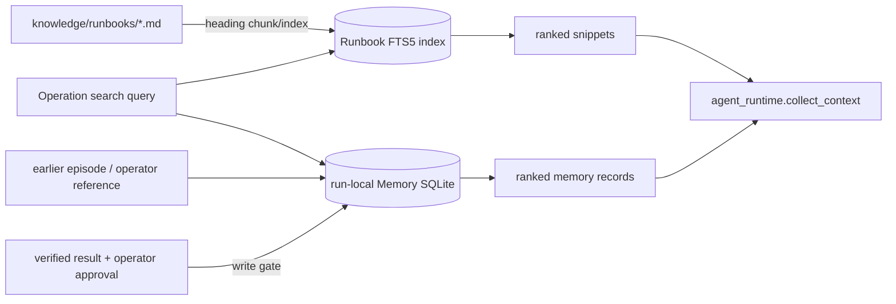

# `ccs.knowledge` — Runbook 검색과 incident Memory

Operation Agent가 NetOps 지식을 가져오는 로컬 retrieval 계층입니다. `RunbookStore`는 check-in 된 영어 운영 문서를 SQLite FTS5에 색인해 BM25 순서로 찾습니다. `MemoryStore`는 반복 episode 사이 incident 경험을 저장하고 검색합니다. 외부 vector service나 network backend는 쓰지 않습니다. 폴더를 검색할 때 쓰는 [`runbook_files(directory)`](../../../docs/reference/python_functions.md#fn-ccs-knowledge-stores-runbook_files)는 이름이 대소문자와 관계없이 `README.md`인 문서를 제외하므로 이 안내 문서를 검색 corpus의 운영 Runbook으로 색인하지 않습니다.

## 폴더 내 파일

| 파일 | 역할 | 함수·메서드 참조 |
|---|---|---|
| [`__init__.py`](__init__.py) | BM25 retrieval과 approved incident Memory package 설명. | [module](../../../docs/reference/python_functions.md#module-ccs-knowledge-__init__) |
| [`stores.py`](stores.py) | `runbook_files(directory)`는 폴더 재귀 검색 시 `README.md`를 제외해 documentation을 Runbook corpus에 섞지 않습니다. 이 helper는 `runner`의 Runbook snapshot/source hashing과 `web_console`의 library discovery에서 공유됩니다. 나머지는 FTS5 연결·Markdown parsing/chunking/index/search, Memory schema/write/search/import를 담당합니다. `RunbookStore.search`와 `MemoryStore.search`는 Operation의 context 단계에서 호출됩니다. | [module](../../../docs/reference/python_functions.md#module-ccs-knowledge-stores) |

## 쓰기와 읽기 경계

- Runbook 문서는 `knowledge/runbooks/`에 두고, 각 문서의 heading와 metadata를 유지합니다. `runner`는 실행별 복사본을 freeze하여 결과가 실행 도중 바뀌지 않게 합니다.
- `MemoryStore.write(record, verified, approved)`는 검증 성공과 승인을 확인하는 일반 저장 경로입니다. `import_reference`는 명시된 operator-seeded experimental context 경로로 들어오는 참조 문서를 다룹니다.
- 검색은 선택된 조건에 따라 Memory ON/OFF를 따릅니다. D0 read 시점에 tenant/scope/expiry filtering을 하지 않는다는 것은 현재 baseline의 의도된 미보호 동작입니다. 이를 protection 기능으로 설명하지 마세요.
- 초안 작성, 운영자 승인, 저장은 각각 다른 단계입니다. 보고서에 memory draft가 있다고 실제 저장되었다고 간주하지 말고 episode 결과를 확인합니다.

더 많은 함수·메서드 세부사항은 [Python 함수 참조](../../../docs/reference/python_functions.md#module-ccs-knowledge-stores), 전체 실행 조건은 [상위 안내](../README.md)와 [STATUS](../../../docs/STATUS.md)에 있습니다.
