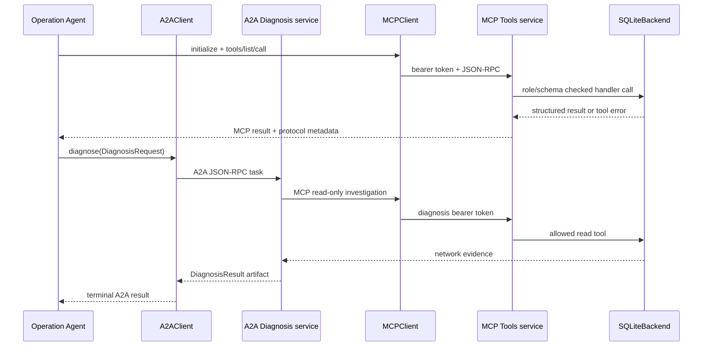

# `ccs.protocols` — MCP/A2A wire boundary

이 패키지는 실제 로컬 child service 간 HTTP protocol 경계를 구현합니다. MCP는 Operation/Diagnosis Agent에서 Network Tools server로 향하고, A2A는 Operation Agent가 Diagnosis Agent에 조사 요청을 넘길 때 사용됩니다. protocol adapter는 agent decision이나 backend SQL을 직접 포함하지 않습니다.

## 누가 누구에게 연결되는가?

## 폴더 내 파일

| 파일 | 역할과 핵심 경계 | 전체 함수·메서드 |
|---|---|---|
| [`__init__.py`](__init__.py) | 공개 wire protocol adapter package 설명. | [module](../../../docs/reference/python_functions.md#module-ccs-protocols-__init__) |
| [`_auth.py`](_auth.py) | `BearerTokenMiddleware`가 보호 route에 bearer token을 확인하고 인증된 role만 ASGI app에 전달합니다. MCP/A2A client가 전달한 role 표기는 신뢰하지 않습니다. | [module](../../../docs/reference/python_functions.md#module-ccs-protocols-_auth) |
| [`a2a.py`](a2a.py) | `build_a2a_app`이 A2A AgentCard와 task endpoint를 구성합니다. `A2AClient.diagnose`가 strict `DiagnosisRequest`를 전송하고 `DiagnosisResult` artifact가 담긴 terminal task까지 기다립니다. `_DiagnosisExecutor`가 handler 호출·idempotency·timeout을 관리합니다. | [module](../../../docs/reference/python_functions.md#module-ccs-protocols-a2a) |
| [`errors.py`](errors.py) | transport, authentication, explicit MCP tool failure, A2A non-success terminal task를 각각 구분하는 public exception hierarchy. | [module](../../../docs/reference/python_functions.md#module-ccs-protocols-errors) |
| [`mcp.py`](mcp.py) | `build_mcp_app`이 role별 tools/list와 call 시점 schema/role 검사를 구성합니다. `MCPClient.list_tools/call`은 one-request-at-a-time client. SDK `tool error`, HTTP/auth, timeout/transport 문제는 별도 예외입니다. | [module](../../../docs/reference/python_functions.md#module-ccs-protocols-mcp) |

## 실제 request 흐름

1. `processes.Services`가 episode마다 tool, diagnosis child service를 시작하고 각 프로세스에 필요한 bearer token과 ephemeral context를 환경/JSON context로 건넵니다.
2. `services.main`의 tools 역할은 `SQLiteBackend`, `tool_schemas`, `build_mcp_app`을 연결합니다. Diagnosis 역할은 `agent_runtime.diagnose`, `InstrumentedTools`, `build_a2a_app`을 연결합니다.
3. `MCPClient`는 role token으로 initialize/list/call을 요청합니다. Server는 token에서 role을 유도하고, 그 role에 노출된 schema인지 실제 호출 때도 확인합니다.
4. `A2AClient.diagnose`는 wire task를 만들고 callback이 완료될 때까지 기다립니다. `DiagnosisRequest.task_id`는 도메인 데이터 안의 ID이며 SDK의 A2A task ID와 구분됩니다.
5. handler가 반환한 값은 provider-independent contract를 통과합니다. timeout, 인증 실패, 명시적 tool error, A2A failed terminal state는 `ProtocolError` 하위 타입으로 상위 Agent/Runner에 보고됩니다.

## 범위 및 문제 해결

- 기본 서비스는 localhost/loopback에서 Runner가 관리하는 child process입니다. 이 client adapter를 외부 network service/production security로 해석하지 마세요.
- Diagnosis token이 있다고 write tool을 호출할 수 있는 것은 아닙니다. role별 list와 call-time gate 양쪽에서 제한됩니다.
- MCP SDK의 `httpx2` transport와 A2A SDK가 쓰는 `httpx`가 별개입니다. 의존성 설치/버전을 바꿀 때 [PROTOCOLS.md](../../../docs/PROTOCOLS.md)와 `requirements.lock`을 같이 확인하세요.
- `ProtocolAuthenticationError`는 bearer 설정, `ProtocolCallError`는 remote tool의 명시적 거부, `ProtocolTransportError`는 통신 실패, `A2ATaskError`는 통신은 됐지만 task 결과가 성공 terminal이 아님을 뜻합니다.
- provider API 호출은 protocol test에 필요하지 않습니다. 검증 범위는 [docs/STATUS.md](../../../docs/STATUS.md)와 [docs/VALIDATION.md](../../../docs/VALIDATION.md)를 확인하세요.

전체 SDK 계약 예시: [MCP/A2A 프로토콜 설계 안내](../../../docs/PROTOCOLS.md). 상위 서비스 연결: [`services.py`](../services.py), [`processes.py`](../processes.py), [전체 흐름](../README.md#한-건의-실행-흐름).
